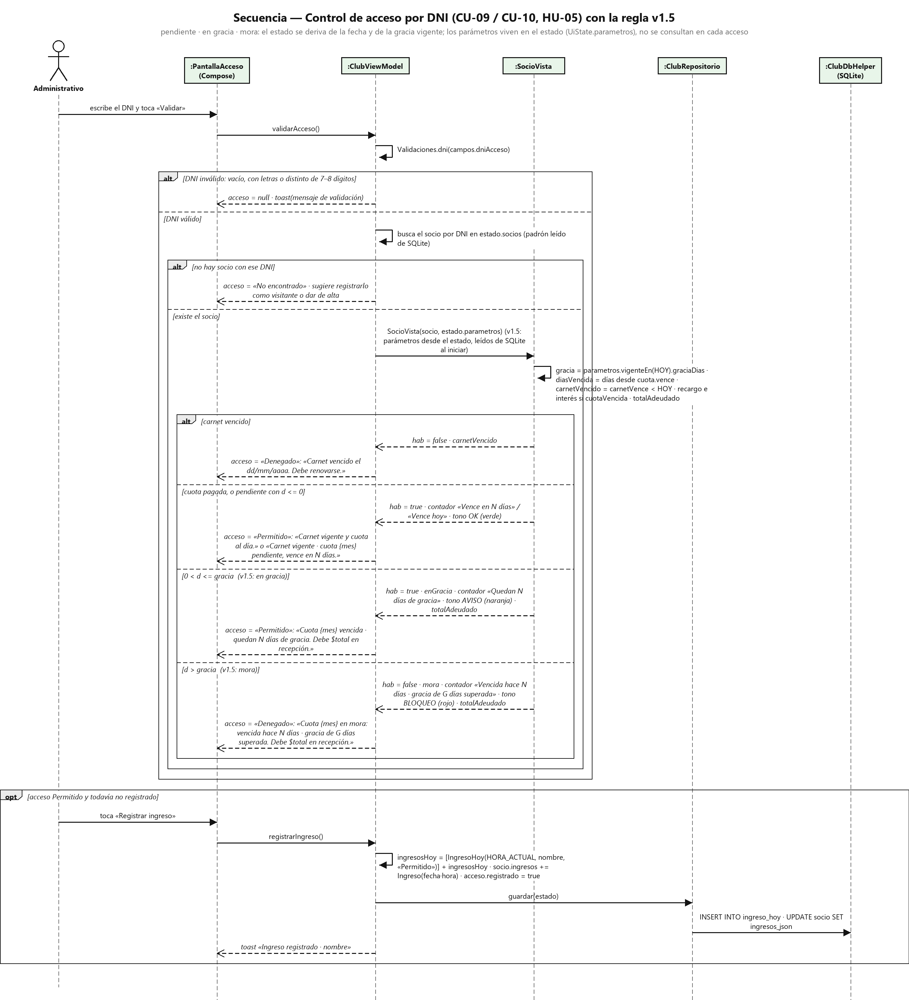
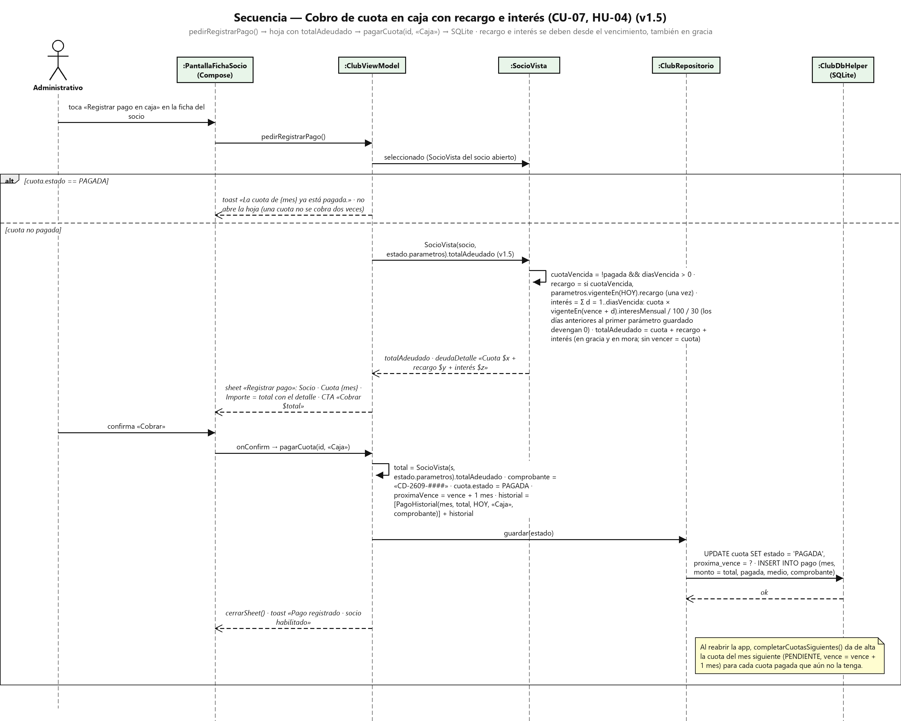
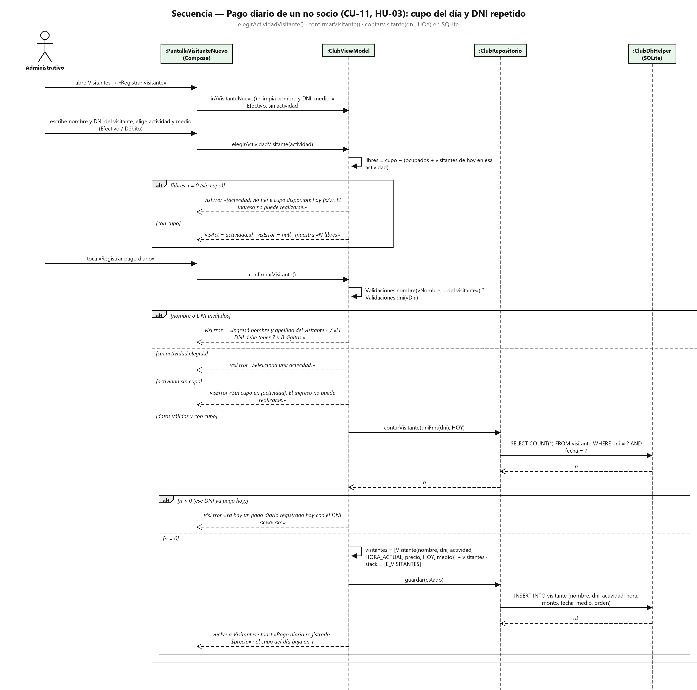
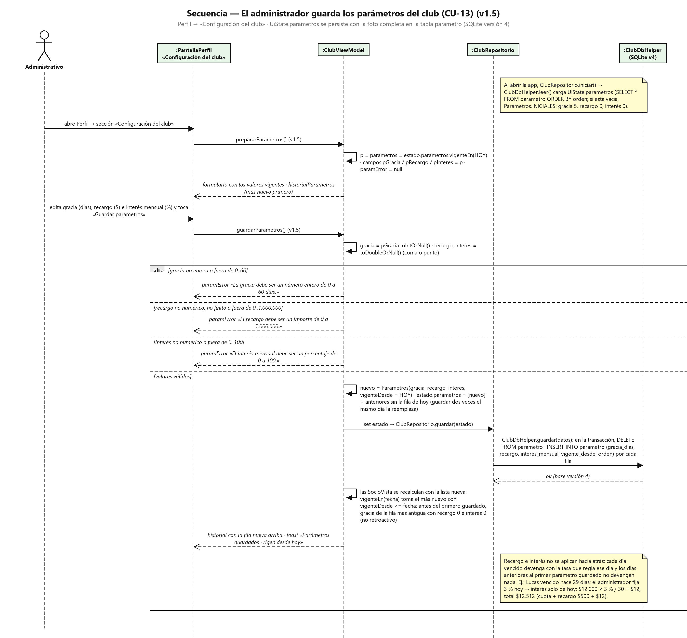
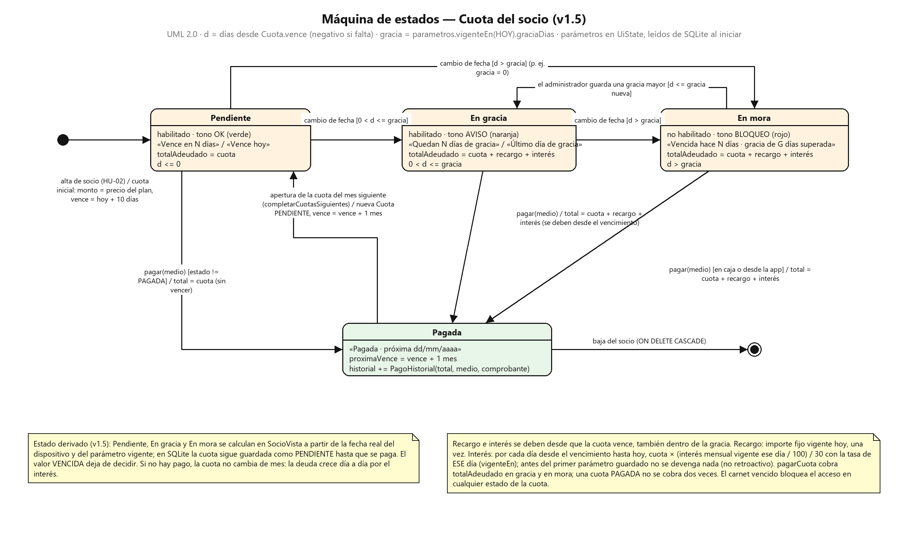

# Casos de uso y diagramas UML 2.0 — Club Deportivo v1.5.0

**Grupo 3** · Alvarez, Aquino Lesme, Mussi, Weitzel · Fecha: 2026-11-08 · Versión de la app: 1.5.0

## 1. Introducción y alcance

Este documento especifica los casos de uso de la app Android «Club Deportivo» (Kotlin + Jetpack Compose + SQLite) y los acompaña con diagramas UML 2.0: casos de uso, clases del dominio, secuencia, máquina de estados y actividad.

La fuente de verdad del comportamiento actual (v1.4.0, rama main) es el código: ClubViewModel.kt (todas las acciones), SocioVista.kt (reglas derivadas), ClubRepositorio.kt y ClubDbHelper.kt (persistencia SQLite), Models.kt, Validaciones.kt, las pantallas de ui/screens y la tabla de historias de usuario del README. Las reglas nuevas de la v1.5.0 (gracia configurable, recargo e interés sobre la deuda, contador de días, parámetros con vigencia, apellido separado y fecha real del dispositivo) salen del spec doc/superpowers/specs/2026-11-08-v1.5.0-gracia-recargos-design.md y se marcan con «(v1.5)». Los escenarios de las pruebas unitarias (ClubViewModelTest, CrudSociosTest, ValidacionesTest) se usaron para los flujos alternativos.

Cada caso de uso corresponde a una función existente en ClubViewModel o a una regla del spec v1.5. Lo que no quedó claro se anota en la lista final «A confirmar» en lugar de suponerse.

## 2. Actores

| Actor | Descripción |
|---|---|
| **Socio** | Persona asociada al club con cuenta en la app (cuenta de demo «Andres»). Paga su cuota, consulta su estado de cuenta, carnet digital, rutina e información nutricional y gestiona su turno con la nutricionista. |
| **Administrativo** | Personal de recepción/caja (cuenta «Jorge», rol ADMIN; el enum también prevé EMPLEADO). Administra el padrón (alta, edición, baja, consulta), cobra cuotas en caja, emite carnets, valida el ingreso por DNI, registra los pagos diarios de no socios, consulta reportes y (v1.5) configura los parámetros del club. |
| **Entrenadora** | Profesora de las actividades (cuenta «Ana», rol PROFESOR). Marca su presencia, toma asistencia por clase y crea y asigna rutinas a los socios habilitados con apto físico. |
| **Nutricionista** | Profesional de nutrición (cuenta «Leandro», rol NUTRICIONISTA). Consulta la agenda de turnos y registra consultas en la ficha nutricional del socio. |
| **No socio / Visitante** | Actor externo que no opera la app: paga un pase diario en el mostrador y el Administrativo lo registra (CU-11). Se modela como beneficiario, no como usuario del sistema. |

## 3. Diagrama de casos de uso (UML 2.0)

Los casos con fondo naranja son nuevos o cambian con el spec v1.5.0. «Calcular estado y deuda de la cuota» es el caso incluido por CU-07, CU-09, CU-14 y CU-15; CU-10 extiende a CU-09 cuando el resultado es «Permitido».

### 3.1 Resumen de casos de uso

| CU | Nombre | Actor principal | HU | Pantalla |
|---|---|---|---|---|
| CU-01 | Iniciar sesión | Usuario del club | HU-01 | PantallaLogin (LoginActivity) → Activity del rol |
| CU-02 | Cerrar sesión | Usuario del club | HU-01 | PantallaPerfil (hoja de confirmación) |
| CU-03 | Consultar socios (búsqueda, filtros y ficha) | Administrativo | HU-02, HU-05, HU-14 | PantallaSocios → PantallaFichaSocio |
| CU-04 | Registrar socio | Administrativo | HU-02 | PantallaAlta (E_ALTA, «Alta de socio») |
| CU-05 | Editar socio | Administrativo | HU-02 (CRUD) | PantallaAlta en modo edición (E_EDITAR, «Editar socio») |
| CU-06 | Dar de baja socio | Administrativo | HU-02 (CRUD) | PantallaFichaSocio (hoja «Dar de baja») |
| CU-07 | Registrar pago de cuota en caja | Administrativo | HU-04 | PantallaFichaSocio (hoja «Registrar pago») |
| CU-08 | Emitir / renovar carnet | Administrativo | HU-07 | PantallaFichaSocio (hoja «Renovar carnet» / «Reemitir carnet») |
| CU-09 | Validar ingreso por DNI (control de acceso) | Administrativo | HU-05 | PantallaAcceso |
| CU-10 | Registrar ingreso del socio («extend» de CU-09) | Administrativo | HU-05 | PantallaAcceso (resultado «Permitido») |
| CU-11 | Registrar pago diario de no socio | Administrativo | HU-03 | PantallaVisitantes → PantallaVisitanteNuevo («Ingreso de visitante») |
| CU-12 | Consultar reportes | Administrativo | HU-14 | PantallaReportes |
| CU-13 | Configurar parámetros del club (v1.5) | Administrativo | Regla de negocio de HU-04 y HU-05 (sin HU nueva; ver «A confirmar») | PantallaPerfil → sección «Configuración del club» |
| CU-14 | Pagar cuota desde la app | Socio | HU-04 | PantallaSocioHome / PantallaCuotas → PantallaPagar → PantallaPagoOk |
| CU-15 | Consultar estado de cuenta, deuda y contador de días | Socio | HU-04 | PantallaSocioHome, PantallaCuotas («Estado de cuenta») |
| CU-16 | Ver carnet digital | Socio | HU-06 | PantallaCarnet |
| CU-17 | Consultar rutina asignada | Socio | HU-10 | PantallaRutinaSocio (y tarjeta «Rutina · hoy» del Inicio) |
| CU-18 | Solicitar turno de nutrición | Socio | HU-11 | PantallaNutriSocio → PantallaTurno («Solicitar turno») |
| CU-19 | Cancelar turno de nutrición | Socio | HU-11 | PantallaNutriSocio (hoja «Cancelar turno») |
| CU-20 | Consultar información nutricional propia | Socio | HU-13 | PantallaNutriSocio |
| CU-21 | Registrar presencia propia | Entrenadora | HU-08 | PantallaProfesorHome |
| CU-22 | Registrar asistencia de clase | Entrenadora | HU-08 | PantallaProfesorHome → PantallaAsistencia |
| CU-23 | Crear y asignar rutina | Entrenadora | HU-09 | PantallaRutinasProfesor → PantallaRutinaEdit («Rutina del socio») |
| CU-24 | Consultar agenda de turnos | Nutricionista | HU-11 | PantallaAgenda |
| CU-25 | Registrar consulta nutricional (ficha nutricional) | Nutricionista | HU-12 | PantallaFichas → PantallaFichaNutricional |

## 4. Especificación de los casos de uso

### CU-01 — Iniciar sesión

| Campo | Detalle |
|---|---|
| Identificador | CU-01 |
| Nombre | Iniciar sesión |
| Actor principal | Usuario del club (Socio, Administrativo, Entrenadora, Nutricionista) |
| HU relacionada | HU-01 |
| Pantalla | PantallaLogin (LoginActivity) → Activity del rol |
| Precondiciones | La app está abierta sin sesión. La cuenta existe en la tabla usuario (semilla: Andres/Socio123, Jorge/Admin123, Ana/Prof123, Leandro/Nut123). |
| Flujo principal | 1. El usuario escribe alias y contraseña (o toca una de las cuentas de prueba listadas, que completa el formulario). 2. Toca «Ingresar» (login()). 3. El sistema normaliza el alias y lo verifica contra la tabla usuario (ClubRepositorio.autenticar → ClubDbHelper.autenticar). 4. El sistema deduce el rol de la cuenta; no hay selector de perfil. 5. Abre la Activity del rol en su pantalla raíz (Socio, Administrativo y Entrenadora → Inicio; Nutricionista → Agenda), limpia los campos y guarda la sesión. |
| Flujos alternativos y de excepción | 2a. Alias o contraseña vacíos → mensaje «Completá usuario y contraseña.»; permanece en el login. 3a. Credenciales inválidas → «Usuario o contraseña incorrectos.»; loginError = true. 3b. La cuenta es de un socio dado de baja (CU-06) → el ingreso se rechaza con el mismo mensaje. |
| Postcondiciones | Sesión iniciada con el rol de la cuenta (tabla sesion); se muestra la barra inferior del rol. |

### CU-02 — Cerrar sesión

| Campo | Detalle |
|---|---|
| Identificador | CU-02 |
| Nombre | Cerrar sesión |
| Actor principal | Usuario del club |
| HU relacionada | HU-01 |
| Pantalla | PantallaPerfil (hoja de confirmación) |
| Precondiciones | Sesión iniciada. |
| Flujo principal | 1. El usuario abre Perfil (pestaña para Socio, Entrenadora y Nutricionista; desde el avatar para el Administrativo) y toca «Cerrar sesión» (pedirCerrarSesion()). 2. El sistema muestra la hoja de confirmación. 3. El usuario confirma (cerrarSesion()). 4. El sistema descarta el rol y la pila de pantallas y vuelve a LoginActivity. |
| Flujos alternativos y de excepción | 3a. Cancela → se cierra la hoja y sigue en Perfil (cancelarCerrarSesion()). |
| Postcondiciones | Sin sesión. Los datos persistidos en SQLite no cambian. |

### CU-03 — Consultar socios (búsqueda, filtros y ficha)

| Campo | Detalle |
|---|---|
| Identificador | CU-03 |
| Nombre | Consultar socios (búsqueda, filtros y ficha) |
| Actor principal | Administrativo |
| HU relacionada | HU-02, HU-05, HU-14 |
| Pantalla | PantallaSocios → PantallaFichaSocio |
| Precondiciones | Sesión de Administrativo. |
| Flujo principal | 1. Abre la pestaña Socios. 2. El sistema lista el padrón leído de SQLite con la etiqueta de estado de cada socio (v1.5: «Habilitado · En gracia», «Habilitado · Cuota pendiente», «Habilitado · Cuota al día», «No habilitado · En mora», «No habilitado · Carnet vencido») y el contador de días con su tono verde / naranja / rojo. 3. Puede escribir en la búsqueda (nombre o DNI, con o sin puntos) y elegir el filtro Todos / Habilitados / En mora (elegirFiltro()). 4. Toca un socio (abrirSocio()) y el sistema muestra la ficha: datos, N° de socio, plan, carnet (emitido / vence / estado), cuota vigente con vencimiento, historial de pagos con comprobantes, actividades, ingresos, ficha médica; (v1.5) total adeudado con el detalle cuota + recargo + interés si la cuota venció. |
| Flujos alternativos y de excepción | 3a. La búsqueda o el filtro no coinciden con nadie → lista vacía. |
| Postcondiciones | Ninguna modificación. Desde la ficha se accede a CU-05, CU-06, CU-07 y CU-08. |

### CU-04 — Registrar socio

| Campo | Detalle |
|---|---|
| Identificador | CU-04 |
| Nombre | Registrar socio |
| Actor principal | Administrativo |
| HU relacionada | HU-02 |
| Pantalla | PantallaAlta (E_ALTA, «Alta de socio») |
| Precondiciones | Sesión de Administrativo. El DNI a registrar no pertenece a otro socio. |
| Flujo principal | 1. Desde Inicio toca «Registrar socio» (irAAlta()): formulario limpio, plan «Full» por defecto, apto físico activo. 2. Completa nombre, apellido (v1.5: campo aparte), DNI, correo, plan (Básico $12.000 / Full $18.500 / Familiar $29.000), apto físico y observaciones. 3. Toca «Registrar socio» (confirmarAlta()). 4. El sistema valida en orden: nombre, apellido (v1.5), DNI (formato), DNI único (COUNT en SQLite), correo. 5. Genera el N° de socio (1500 + cantidad de socios; si ese número ya existe por una baja, el siguiente libre), emite el carnet (hoy → hoy + 12 meses − 1 día) y crea la cuota inicial PENDIENTE (precio del plan, vence hoy + 10 días) y la ficha nutricional inicial. 6. Agrega el socio al padrón y lo guarda en SQLite; navega a Socios → Ficha del socio con el toast «Socio N° xxxxx registrado · carnet y cuota inicial generados». |
| Flujos alternativos y de excepción | 4a. Nombre vacío o sin apellido → «Ingresá nombre y apellido.»; con caracteres no permitidos → «El nombre solo puede contener letras y espacios.» 4b. (v1.5) Apellido vacío o con caracteres no permitidos → mensaje equivalente para el apellido. 4c. DNI vacío → «Ingresá el DNI.»; con letras → «El DNI solo puede contener números.»; distinto de 7 u 8 dígitos → «El DNI debe tener 7 u 8 dígitos.» 4d. DNI ya registrado → «Ya existe un socio con ese DNI.» 4e. Correo vacío → «Ingresá el correo electrónico.»; formato inválido → «El correo electrónico no tiene un formato válido (ej.: nombre@dominio.com).» En todos los casos el error se muestra bajo el formulario (altaError) y se permanece en «Alta de socio». |
| Postcondiciones | Socio persistido (tablas socio, carnet, cuota) con N° único, carnet vigente 12 meses, cuota inicial pendiente, sin rutina ni turno, IMC «—»; nace habilitado. |

### CU-05 — Editar socio

| Campo | Detalle |
|---|---|
| Identificador | CU-05 |
| Nombre | Editar socio |
| Actor principal | Administrativo |
| HU relacionada | HU-02 (CRUD) |
| Pantalla | PantallaAlta en modo edición (E_EDITAR, «Editar socio») |
| Precondiciones | Ficha de un socio abierta (CU-03). |
| Flujo principal | 1. Toca «Editar datos» (irAEditar()). 2. El sistema precarga nombre (v1.5: nombre y apellido partidos en el primer espacio), DNI, correo, plan, apto físico y observaciones. 3. Modifica los datos y toca «Guardar cambios» (confirmarAlta() → guardarEdicion()). 4. El sistema valida igual que el alta; el DNI puede coincidir con el del propio socio (contarDni excluye su id). 5. Guarda nombre, DNI, correo, plan, apto físico y antecedentes; vuelve a la ficha con el toast «Datos del socio actualizados». |
| Flujos alternativos y de excepción | 4a. Cualquier validación falla → altaError bajo el formulario; permanece en «Editar socio». |
| Postcondiciones | Cambios persistidos en SQLite. El cambio de plan rige desde la próxima cuota: la cuota emitida, el carnet y el historial no se modifican. |

### CU-06 — Dar de baja socio

| Campo | Detalle |
|---|---|
| Identificador | CU-06 |
| Nombre | Dar de baja socio |
| Actor principal | Administrativo |
| HU relacionada | HU-02 (CRUD) |
| Pantalla | PantallaFichaSocio (hoja «Dar de baja») |
| Precondiciones | Ficha de un socio abierta. |
| Flujo principal | 1. Toca «Dar de baja» (pedirBajaSocio()). 2. El sistema muestra la hoja con Socio, DNI y N° de socio y la advertencia de que la acción no se puede deshacer. 3. Confirma «Confirmar baja». 4. El sistema quita al socio del padrón, de los inscriptos de las actividades y de las asistencias; vuelve a Socios con el toast «{nombre} dado de baja». |
| Flujos alternativos y de excepción | 3a. Cancela → se cierra la hoja y el socio sigue en el padrón. |
| Postcondiciones | Filas eliminadas en SQLite (carnet, cuota y pagos por ON DELETE CASCADE). Si era el socio de la cuenta de la app, esa cuenta ya no puede iniciar sesión (CU-01, 3b). El N° del próximo alta no repite ninguno existente. |

### CU-07 — Registrar pago de cuota en caja

| Campo | Detalle |
|---|---|
| Identificador | CU-07 |
| Nombre | Registrar pago de cuota en caja |
| Actor principal | Administrativo |
| HU relacionada | HU-04 |
| Pantalla | PantallaFichaSocio (hoja «Registrar pago») |
| Precondiciones | Ficha de un socio abierta; la cuota vigente no está pagada. |
| Flujo principal | 1. Toca «Registrar pago en caja» (pedirRegistrarPago()). 2. (v1.5) El sistema calcula el importe con SocioVista(socio, parametros).totalAdeudado: si la cuota ya venció (en gracia o en mora), total = cuota + recargo (importe fijo vigente hoy, una vez) + interés (por cada día desde el vencimiento hasta hoy, cuota × interés mensual vigente ESE día / 100 / 30; los días anteriores al primer parámetro guardado no devengan); si no venció, total = cuota. 3. Muestra la hoja «Registrar pago» con Socio, Cuota (mes) e Importe (detalle «Cuota $x + recargo $y + interés $z» cuando corresponde) y el botón «Cobrar $total». 4. Confirma. El sistema ejecuta pagarCuota(id, «Caja»): la cuota pasa a PAGADA, proximaVence = vence + 1 mes, se antepone PagoHistorial(mes, total, hoy, «Caja», comprobante «CD-2609-####»). 5. Guarda en SQLite (UPDATE cuota, INSERT pago), cierra la hoja y muestra «Pago registrado · socio habilitado». |
| Flujos alternativos y de excepción | 1a. La cuota ya está pagada → toast «La cuota de {mes} ya está pagada.» y la hoja no se abre (una cuota no se cobra dos veces). 4a. Cancela la hoja → nada cambia. |
| Postcondiciones | Cuota pagada con comprobante; el socio queda habilitado si su carnet está vigente; sale de los listados «Vencen hoy» y «En mora». Al reabrir la app, completarCuotasSiguientes() crea la cuota del mes siguiente. |
| (v1.5) | Recargo e interés se deben desde que la cuota vence, también dentro de la gracia, pero no se aplican hacia atrás: con Lucas vencido hace 29 días y un 3 % fijado hoy, el interés es solo el de hoy ($12.000 × 3 % / 30 = $12) y el total $12.512 (cuota + recargo $500 + $12). El historial guarda monto = total cobrado. |

### CU-08 — Emitir / renovar carnet

| Campo | Detalle |
|---|---|
| Identificador | CU-08 |
| Nombre | Emitir / renovar carnet |
| Actor principal | Administrativo |
| HU relacionada | HU-07 |
| Pantalla | PantallaFichaSocio (hoja «Renovar carnet» / «Reemitir carnet») |
| Precondiciones | Ficha de un socio abierta. |
| Flujo principal | 1. Toca la acción del carnet (pedirRenovarCarnet()); el título es «Renovar carnet» si venció o «Reemitir carnet» si está vigente. 2. El sistema muestra la hoja con Socio y «Nueva vigencia»: hoy → hoy + 12 meses − 1 día. 3. Confirma «Emitir carnet». 4. El sistema actualiza carnetEmitido y carnetVence y muestra «Carnet emitido · vigente hasta dd/mm/aaaa». |
| Flujos alternativos y de excepción | 3a. Cancela → el carnet no cambia. |
| Postcondiciones | Carnet vigente 12 meses persistido (tabla carnet). Si el socio estaba bloqueado solo por carnet vencido, queda habilitado; el carnet digital del socio (CU-16) muestra la nueva vigencia. |

### CU-09 — Validar ingreso por DNI (control de acceso)

| Campo | Detalle |
|---|---|
| Identificador | CU-09 |
| Nombre | Validar ingreso por DNI (control de acceso) |
| Actor principal | Administrativo |
| HU relacionada | HU-05 |
| Pantalla | PantallaAcceso |
| Precondiciones | Sesión de Administrativo. |
| Flujo principal | 1. Escribe el DNI (con o sin puntos) y toca «Validar» (validarAcceso()), o toca un socio sugerido (ponerDniAcceso()). 2. El sistema valida el formato del DNI. 3. Busca el socio por DNI en el padrón. 4. (v1.5) Construye SocioVista(socio, parametros) con los parámetros del estado (leídos de SQLite al iniciar la app): días vencida, gracia vigente hoy, recargo e interés; evalúa carnet y cuota. 5. Muestra el resultado «Permitido» (verde): con cuota pagada «Carnet vigente y cuota al día.»; con cuota pendiente «Carnet vigente · cuota {mes} pendiente, vence en N días.» (o «vence hoy»). |
| Flujos alternativos y de excepción | 2a. DNI inválido → toast con el mensaje de validación y sin resultado. 3a. No hay socio con ese DNI → «No encontrado»: «No hay ningún socio con DNI xx.xxx.xxx. Podés registrarlo como visitante o dar de alta un socio.» (atajos a CU-11 y CU-04). 4a. Carnet vencido → «Denegado»: «Carnet vencido el dd/mm/aaaa. Debe renovarse.» (CU-08). 4b. (v1.5) 0 < d <= gracia → «Permitido» (naranja): «Cuota {mes} vencida · quedan N días de gracia. Debe $total en recepción.» (con «queda 1 día de gracia» o «último día de gracia» cuando quedan 0). 4c. (v1.5) d > gracia → «Denegado» (rojo): «Cuota {mes} en mora: vencida hace N días · gracia de G días superada. Debe $total en recepción.» |
| Postcondiciones | Resultado en pantalla; nada se persiste hasta CU-10. |
| (v1.5) | En v1.4 la mora era el estado guardado VENCIDA; en v1.5 se deriva de la fecha y de la gracia configurada en CU-13, sin consultar SQLite en cada acceso. |

### CU-10 — Registrar ingreso del socio («extend» de CU-09)

| Campo | Detalle |
|---|---|
| Identificador | CU-10 |
| Nombre | Registrar ingreso del socio («extend» de CU-09) |
| Actor principal | Administrativo |
| HU relacionada | HU-05 |
| Pantalla | PantallaAcceso (resultado «Permitido») |
| Precondiciones | Resultado «Permitido» de CU-09 todavía no registrado. |
| Flujo principal | 1. Toca «Registrar ingreso» (registrarIngreso()). 2. El sistema antepone IngresoHoy(hora actual, nombre, «Permitido») a los ingresos del día y Ingreso(fecha · hora, «Permitido») al historial del socio; marca acceso.registrado = true. 3. Guarda en SQLite (ingreso_hoy, ingresos_json) y muestra «Ingreso registrado · {nombre}». |
| Flujos alternativos y de excepción | 1a. El ingreso ya fue registrado para ese resultado → no se vuelve a registrar (registrado = true). |
| Postcondiciones | KPI «Ingresos de hoy» del Inicio +1; el ingreso figura en la ficha del socio. |

### CU-11 — Registrar pago diario de no socio

| Campo | Detalle |
|---|---|
| Identificador | CU-11 |
| Nombre | Registrar pago diario de no socio |
| Actor principal | Administrativo (beneficiario: No socio / Visitante) |
| HU relacionada | HU-03 |
| Pantalla | PantallaVisitantes → PantallaVisitanteNuevo («Ingreso de visitante») |
| Precondiciones | Sesión de Administrativo. Hay actividades con cupo del día. |
| Flujo principal | 1. Desde Inicio («Registrar visitante») o desde Visitantes toca nuevo ingreso (irAVisitanteNuevo()): nombre y DNI vacíos, medio Efectivo, sin actividad. 2. Escribe nombre y apellido y DNI del visitante; elige la actividad (elegirActividadVisitante()) y el medio de pago (Efectivo / Débito). 3. El sistema muestra el cupo del día de cada actividad: libres = cupo − (ocupados + visitantes de hoy). 4. Toca «Registrar pago diario» (confirmarVisitante()). 5. El sistema valida nombre y DNI, la actividad y su cupo, y consulta en SQLite si ese DNI ya pagó hoy (contarVisitante(dni, HOY)). 6. Registra Visitante(nombre, DNI con puntos, actividad, hora actual, monto = precio de la actividad, fecha de hoy, medio), lo guarda (INSERT visitante), vuelve a Visitantes y muestra «Pago diario registrado · $precio». |
| Flujos alternativos y de excepción | 2a. La actividad elegida no tiene cupo → «{actividad} no tiene cupo disponible hoy (x/y). El ingreso no puede realizarse.» 5a. Nombre o DNI inválidos → visError con el mensaje de Validaciones («Ingresá nombre y apellido del visitante.», «El DNI debe tener 7 u 8 dígitos.», …). 5b. Sin actividad elegida → «Seleccioná una actividad.» 5c. Actividad sin cupo → «Sin cupo en {actividad}. El ingreso no puede realizarse.» 5d. El DNI ya tiene un pago diario hoy → «Ya hay un pago diario registrado hoy con el DNI xx.xxx.xxx.» |
| Postcondiciones | Pago diario persistido con fecha y medio; aparece en Visitantes (hoy) con el total del día y en Reportes → «Pagos diarios» por fecha (CU-12); el cupo del día baja en 1 y el KPI de ingresos de hoy sube en 1. |

### CU-12 — Consultar reportes

| Campo | Detalle |
|---|---|
| Identificador | CU-12 |
| Nombre | Consultar reportes |
| Actor principal | Administrativo |
| HU relacionada | HU-14 |
| Pantalla | PantallaReportes |
| Precondiciones | Sesión de Administrativo. |
| Flujo principal | 1. Abre la pestaña Reportes. 2. Elige una pestaña (elegirReportTab()): «Vencen hoy» (cuotas pendientes con vencimiento hoy, SELECT por rango en SQLite), «Esta semana» (de mañana a 7 días), «En mora» (socios no habilitados por cuota), «Pagos diarios» (visitantes del día elegido). 3. El sistema muestra las filas ordenadas por vencimiento (o por hora) y el total: suma de cuotas o suma de pagos diarios con su medio. 4. En «Pagos diarios» navega al día anterior / siguiente (diaReporteAnterior/Siguiente); no se puede avanzar más allá de hoy. 5. (v1.5) En «En mora» cada socio muestra el total adeudado (totalAdeudado) con el detalle cuota + recargo + interés y el total de la pestaña es la suma de esos totales; una sección «Parámetros vigentes» muestra el historial de gracia, recargo e interés por fecha. |
| Flujos alternativos y de excepción | 3a. La pestaña no tiene filas → texto vacío y total $0. |
| Postcondiciones | Ninguna modificación. Cobrar una cuota (CU-07) la saca de «Vencen hoy» y «En mora». |

### CU-13 — Configurar parámetros del club (v1.5)

| Campo | Detalle |
|---|---|
| Identificador | CU-13 |
| Nombre | Configurar parámetros del club (v1.5) |
| Actor principal | Administrativo |
| HU relacionada | Regla de negocio de HU-04 y HU-05 (sin HU nueva; ver «A confirmar») |
| Pantalla | PantallaPerfil → sección «Configuración del club» |
| Precondiciones | Sesión de Administrativo. Base SQLite versión 4 con la tabla parametro (Parametros.INICIALES: gracia 5 días, recargo 0, interés 0, vigente desde hoy). |
| Flujo principal | 1. Abre Perfil → «Configuración del club». El sistema carga el formulario con los valores vigentes hoy (prepararParametros() → campos pGracia, pRecargo, pInteres) y muestra el historial por fecha, más nuevo primero (historialParametros). 2. Edita el período de gracia (días enteros, 0..60), el recargo (importe fijo en pesos, decimal, con coma o punto) y el interés mensual (%, 0..100) y toca «Guardar parámetros» (guardarParametros()). 3. El sistema valida y arma Parametros(gracia, recargo, interés, vigenteDesde = hoy); lo antepone a la lista del estado quitando cualquier otra fila de hoy (guardar dos veces el mismo día reemplaza la de hoy). 4. El setter de estado llama a ClubRepositorio.guardar → ClubDbHelper.guardar, que reescribe la tabla parametro (DELETE + INSERT de todas las filas, con orden) dentro de la transacción; toast «Parámetros guardados · rigen desde hoy». 5. Las SocioVista se recalculan con la lista nueva: estado derivado (pendiente / en gracia / mora), total adeudado y contador de todos los socios. |
| Flujos alternativos y de excepción | 3a. Gracia no entera o fuera de 0..60 → «La gracia debe ser un número entero de 0 a 60 días.» 3b. Recargo no numérico, no finito o fuera de 0..1.000.000 → «El recargo debe ser un importe de 0 a 1.000.000.» 3c. Interés no numérico o fuera de 0..100 → «El interés mensual debe ser un porcentaje de 0 a 100.» En los tres casos el error se muestra en el formulario (paramError) y no se guarda nada. |
| Postcondiciones | Los parámetros rigen desde hoy inclusive: List<Parametros>.vigenteEn(fecha) toma el más nuevo con vigenteDesde <= fecha; para fechas anteriores al primer parámetro guardado devuelve la gracia de la fila más antigua con recargo 0 e interés 0 (recargo e interés no se aplican hacia atrás). El interés se devenga día a día desde el vencimiento con la tasa que regía cada día; los días previos a que el administrador fijara la primera tasa no devengan nada. Tabla parametro(id, gracia_dias, recargo, interes_mensual, vigente_desde, orden), base versión 4; la lista vuelve a cargarse en ClubRepositorio.iniciar() → ClubDbHelper.leer() al abrir la app. |
| (v1.5) | Caso nuevo definido íntegramente por el spec v1.5.0 (objetivo 2 y decisiones). |

### CU-14 — Pagar cuota desde la app

| Campo | Detalle |
|---|---|
| Identificador | CU-14 |
| Nombre | Pagar cuota desde la app |
| Actor principal | Socio |
| HU relacionada | HU-04 |
| Pantalla | PantallaSocioHome / PantallaCuotas → PantallaPagar → PantallaPagoOk |
| Precondiciones | Sesión de Socio; la cuota vigente no está pagada. |
| Flujo principal | 1. Toca «Pagar» en el Inicio o «Pagar cuota» en Estado de cuenta. 2. Elige el medio (elegirMedio()): Tarjeta de débito / crédito, Billetera virtual o Efectivo en el club (cupón para recepción). 3. (v1.5) El sistema muestra el importe total (totalAdeudado): cuota, más recargo e interés si la cuota ya venció (en gracia o en mora). 4. Toca «Confirmar pago de $total» (confirmarPago()). 5. El sistema ejecuta pagarCuota(socio de la app, medio): cuota PAGADA, proximaVence = vence + 1 mes, PagoHistorial con comprobante «CD-2609-####»; guarda en SQLite. 6. Reemplaza la pantalla de pago por «Pago OK» con el comprobante (sin barra inferior). |
| Flujos alternativos y de excepción | 4a. La cuota ya estaba pagada → toast «La cuota de {mes} ya está pagada.», no se registra otro pago ni se navega al comprobante. |
| Postcondiciones | Igual que CU-07. No hay pasarela de pago real: el pago se registra en la base, tal como define el diseño. |

### CU-15 — Consultar estado de cuenta, deuda y contador de días

| Campo | Detalle |
|---|---|
| Identificador | CU-15 |
| Nombre | Consultar estado de cuenta, deuda y contador de días |
| Actor principal | Socio |
| HU relacionada | HU-04 |
| Pantalla | PantallaSocioHome, PantallaCuotas («Estado de cuenta») |
| Precondiciones | Sesión de Socio. |
| Flujo principal | 1. En el Inicio el sistema muestra la tarjeta de la cuota: mes, monto, estado (Pagada / Pendiente / Vencida) y «Vence en N días · dd/mm/aaaa», «Vence hoy» o «Venció hace N días». 2. (v1.5) Muestra el contador con su tono: «Vence en N días» / «Vence hoy» (OK, verde), «Quedan N días de gracia» / «Queda 1 día de gracia» / «Último día de gracia» (AVISO, naranja), «Vencida hace N días · gracia de G días superada» (BLOQUEO, rojo) y «Pagada»; si la cuota venció, el total adeudado con el detalle «Cuota $x + recargo $y + interés $z» (interés devengado día a día desde el vencimiento con la tasa de cada día; nada antes del primer parámetro guardado). 3. Abre «Estado de cuenta»: cuota vigente y el historial de pagos con fecha, medio y comprobante; si la cuota está pagada, «Pagada · próxima dd/mm/aaaa». |
| Flujos alternativos y de excepción | 2a. En mora → además se avisa que el acceso está bloqueado hasta regularizar (CU-14 o CU-07). |
| Postcondiciones | Ninguna modificación. |
| (v1.5) | Contador de días y deuda del socio: objetivos 4 y 5 del spec. |

### CU-16 — Ver carnet digital

| Campo | Detalle |
|---|---|
| Identificador | CU-16 |
| Nombre | Ver carnet digital |
| Actor principal | Socio |
| HU relacionada | HU-06 |
| Pantalla | PantallaCarnet |
| Precondiciones | Sesión de Socio. |
| Flujo principal | 1. Abre la pestaña Carnet. 2. El sistema muestra el carnet digital: nombre, N° de socio, DNI, plan, foto, fecha de emisión y de vencimiento y el estado Vigente / Por vencer (menos de 30 días) / Vencido. |
| Flujos alternativos y de excepción | 2a. Carnet vencido → estado «Vencido»; el socio debe renovarlo en recepción (CU-08). |
| Postcondiciones | Ninguna modificación. |

### CU-17 — Consultar rutina asignada

| Campo | Detalle |
|---|---|
| Identificador | CU-17 |
| Nombre | Consultar rutina asignada |
| Actor principal | Socio |
| HU relacionada | HU-10 |
| Pantalla | PantallaRutinaSocio (y tarjeta «Rutina · hoy» del Inicio) |
| Precondiciones | Sesión de Socio. |
| Flujo principal | 1. Abre la pestaña Rutina. 2. El sistema muestra nombre de la rutina, profesora, fecha de actualización y los días; el socio cambia de día (elegirDiaRutina()) y ve los ejercicios numerados con series × repeticiones. |
| Flujos alternativos y de excepción | 2a. Sin rutina asignada → «Sin rutina asignada» o «Sin rutina · falta ficha médica» según el apto físico. |
| Postcondiciones | Ninguna modificación. |

### CU-18 — Solicitar turno de nutrición

| Campo | Detalle |
|---|---|
| Identificador | CU-18 |
| Nombre | Solicitar turno de nutrición |
| Actor principal | Socio |
| HU relacionada | HU-11 |
| Pantalla | PantallaNutriSocio → PantallaTurno («Solicitar turno») |
| Precondiciones | Sesión de Socio sin turno vigente. |
| Flujo principal | 1. En Nutrición toca «Solicitar turno». 2. El sistema muestra la grilla de días y horarios; los ya tomados por otros socios aparecen ocupados. 3. Elige un horario libre (elegirSlot()) y toca «Confirmar turno» (confirmarTurno()). 4. El sistema guarda Turno(fecha, hora), vuelve a Nutrición y muestra «Turno confirmado · dd/mm hh:mm». |
| Flujos alternativos y de excepción | 3a. No eligió horario → toast «Elegí un horario disponible». |
| Postcondiciones | Turno persistido (turno_fecha, turno_hora); aparece en la agenda de la nutricionista (CU-24). |

### CU-19 — Cancelar turno de nutrición

| Campo | Detalle |
|---|---|
| Identificador | CU-19 |
| Nombre | Cancelar turno de nutrición |
| Actor principal | Socio |
| HU relacionada | HU-11 |
| Pantalla | PantallaNutriSocio (hoja «Cancelar turno») |
| Precondiciones | Sesión de Socio con turno vigente. |
| Flujo principal | 1. Toca «Cancelar turno» (pedirCancelarTurno()). 2. El sistema muestra la hoja con el turno a liberar. 3. Confirma «Sí, cancelar»; el sistema borra el turno y muestra «Turno cancelado». |
| Flujos alternativos y de excepción | 3a. Cancela la hoja → el turno se mantiene. |
| Postcondiciones | Horario liberado para otros socios. |

### CU-20 — Consultar información nutricional propia

| Campo | Detalle |
|---|---|
| Identificador | CU-20 |
| Nombre | Consultar información nutricional propia |
| Actor principal | Socio |
| HU relacionada | HU-13 |
| Pantalla | PantallaNutriSocio |
| Precondiciones | Sesión de Socio. |
| Flujo principal | 1. Abre la pestaña Nutrición. 2. El sistema muestra peso, altura e IMC (o «—» si no hay medidas), objetivo, antecedentes, el historial de consultas (fecha, peso, observaciones), el turno vigente y la nutricionista. |
| Flujos alternativos y de excepción | 2a. Sin consultas → «Sin consultas registradas». |
| Postcondiciones | Ninguna modificación. |

### CU-21 — Registrar presencia propia

| Campo | Detalle |
|---|---|
| Identificador | CU-21 |
| Nombre | Registrar presencia propia |
| Actor principal | Entrenadora |
| HU relacionada | HU-08 |
| Pantalla | PantallaProfesorHome |
| Precondiciones | Sesión de Entrenadora. |
| Flujo principal | 1. En el Inicio toca marcar presencia (marcarPresencia()). 2. El sistema registra profePresente = true y muestra «Presencia registrada · hh:mm». |
| Flujos alternativos y de excepción | — |
| Postcondiciones | Presencia persistida en la tabla sesion (profe_presente). |

### CU-22 — Registrar asistencia de clase

| Campo | Detalle |
|---|---|
| Identificador | CU-22 |
| Nombre | Registrar asistencia de clase |
| Actor principal | Entrenadora |
| HU relacionada | HU-08 |
| Pantalla | PantallaProfesorHome → PantallaAsistencia |
| Precondiciones | Sesión de Entrenadora; la clase es suya (Musculación 18:00, Funcional 19:30). |
| Flujo principal | 1. Desde el Inicio toca una clase (abrirAsistencia()) o en la pestaña Asistencia elige la clase (elegirClase()). 2. El sistema lista los inscriptos con su marca de presente. 3. Toca cada socio para alternar presente / ausente (alternarAsistencia()). 4. Toca «Guardar asistencia» (guardarAsistencia()); el sistema muestra «Asistencia guardada · {clase} · n/m presentes» y vuelve al Inicio. |
| Flujos alternativos y de excepción | 3a. Cambia de clase → cada clase conserva su propia lista de presentes. |
| Postcondiciones | Asistencia por clase persistida (asistencia_clase, asistencia); el Inicio muestra presentes / inscriptos. |

### CU-23 — Crear y asignar rutina

| Campo | Detalle |
|---|---|
| Identificador | CU-23 |
| Nombre | Crear y asignar rutina |
| Actor principal | Entrenadora |
| HU relacionada | HU-09 |
| Pantalla | PantallaRutinasProfesor → PantallaRutinaEdit («Rutina del socio») |
| Precondiciones | Sesión de Entrenadora. El socio pertenece a sus actividades. |
| Flujo principal | 1. Abre Rutinas: lista de socios de Musculación / Funcional con «Crear» o «Ver» y las rutinas pendientes. 2. Abre un socio (abrirRutina()); si no tenía rutina el editor arranca con tres días vacíos. 3. Elige el día (elegirDiaEdicion()), escribe el ejercicio, series (1..20) y repeticiones (1..100) y toca «Nuevo ejercicio» (agregarEjercicio()); puede quitar ejercicios (quitarEjercicio()). 4. Toca «Guardar y asignar rutina» (guardarRutina()): se guardan los días con ejercicios, nombre «Rutina personalizada» (o el anterior), profesora y fecha de hoy; toast «Rutina asignada a {nombre} · visible en su app». |
| Flujos alternativos y de excepción | 2a. El socio no está habilitado (cuota en mora o carnet vencido) o no tiene apto físico → la asignación se bloquea con el motivo («cuota en mora», «carnet vencido», «falta la ficha médica»). 3a. Nombre del ejercicio vacío → «Ingresá el nombre del ejercicio»; series o repeticiones no enteras o fuera de rango → «Las series deben estar entre 1 y 20.» / «Las repeticiones deben estar entre 1 y 100.» 4a. Ningún día con ejercicios → «Agregá al menos un ejercicio». |
| Postcondiciones | Rutina persistida (rutina_json) y visible para el socio (CU-17). |

### CU-24 — Consultar agenda de turnos

| Campo | Detalle |
|---|---|
| Identificador | CU-24 |
| Nombre | Consultar agenda de turnos |
| Actor principal | Nutricionista |
| HU relacionada | HU-11 |
| Pantalla | PantallaAgenda |
| Precondiciones | Sesión de Nutricionista. |
| Flujo principal | 1. Abre la pestaña Agenda. 2. El sistema agrupa los turnos por día (hoy y los próximos), ordenados por hora, con el nombre del socio. 3. Toca un turno para abrir la ficha nutricional del socio (abrirFicha(), CU-25). |
| Flujos alternativos y de excepción | 2a. Un día sin turnos no se lista. |
| Postcondiciones | Ninguna modificación. |

### CU-25 — Registrar consulta nutricional (ficha nutricional)

| Campo | Detalle |
|---|---|
| Identificador | CU-25 |
| Nombre | Registrar consulta nutricional (ficha nutricional) |
| Actor principal | Nutricionista |
| HU relacionada | HU-12 |
| Pantalla | PantallaFichas → PantallaFichaNutricional |
| Precondiciones | Sesión de Nutricionista; socio elegido desde Agenda o Fichas. |
| Flujo principal | 1. El sistema muestra la ficha: datos del socio, peso, altura, IMC, objetivo, antecedentes e historial de consultas. 2. En «Registrar consulta de hoy» ingresa peso (kg, obligatorio, 20..300, con coma o punto), altura (m, opcional, 0,50..2,50) y observaciones. 3. Toca «Guardar en historial» (guardarConsulta()). 4. El sistema actualiza peso y altura, antepone Consulta(hoy, peso, observaciones o «Control de rutina.»), consume el turno si era de hoy, limpia el formulario y muestra «Consulta guardada en el historial». |
| Flujos alternativos y de excepción | 3a. Peso vacío → «Ingresá el peso.»; no numérico → «El peso debe ser un número (ej.: 62,4).»; fuera de rango → «El peso debe estar entre 20 y 300 kg.» 3b. Altura no numérica → «La altura debe ser un número en metros (ej.: 1,68).»; fuera de rango → «La altura debe estar entre 0,50 y 2,50 m.» |
| Postcondiciones | Consulta persistida (consultas_json, nut_peso, nut_altura); el turno de hoy queda liberado; el socio la ve en CU-20. |

## 5. Diagrama de clases del dominio (UML 2.0)

Modelo tomado de data/Models.kt: Socio (el carnet son sus atributos carnetEmitido / carnetVence), Cuota, PagoHistorial, Plan, Actividad, Visitante, Rutina → DiaRutina → Ejercicio, FichaNutricional → Consulta, Turno, Ingreso, Usuario y Rol. SocioVista es la clase derivada que aplica la regla de habilitación. Parametros (v1.5) es la entidad nueva con vigencia por fecha; EstadoCuota.VENCIDA deja de decidir la mora.

## 6. Diagramas de secuencia (UML 2.0)

Participantes: la pantalla Compose, ClubViewModel, SocioVista (reglas derivadas), ClubRepositorio y ClubDbHelper (SQLite).

### 6.1 Control de acceso por DNI con la regla de habilitación (CU-09 / CU-10) (v1.5)

validarAcceso() valida el DNI, busca el socio y construye SocioVista(socio, parametros) con los parámetros del estado (leídos de SQLite al iniciar la app, sin consulta por acceso). El resultado se deriva de la fecha y la gracia vigente: carnet vencido (denegado), cuota pagada o pendiente sin vencer (permitido), en gracia (permitido con aviso y total adeudado) o en mora (denegado, con el total). Si es «Permitido», registrarIngreso() persiste el ingreso del día.

### 6.2 Cobro de cuota en caja con recargo e interés (CU-07) (v1.5)

pedirRegistrarPago() rechaza la cuota ya pagada; si no, SocioVista calcula totalAdeudado (cuota + recargo + interés desde el vencimiento, también en gracia) con los parámetros del estado, la hoja lo muestra y, al confirmar, pagarCuota(id, «Caja») marca la cuota como pagada, abre la siguiente y guarda el pago por el total con su comprobante en SQLite.

### 6.3 Registro de pago diario de un no socio (CU-11)

elegirActividadVisitante() avisa si la actividad no tiene cupo hoy; confirmarVisitante() valida nombre y DNI, actividad y cupo, consulta en SQLite si ese DNI ya pagó hoy y, si no, inserta el Visitante con fecha, hora, monto y medio.

### 6.4 El administrador guarda los parámetros del club (CU-13) (v1.5)

La sección «Configuración del club» del Perfil carga el formulario con prepararParametros() y muestra historialParametros; guardarParametros() valida, antepone Parametros(vigenteDesde = hoy) a la lista del estado (reemplazando la fila de hoy si existe) y el setter de estado persiste la foto completa: ClubRepositorio.guardar → ClubDbHelper.guardar reescribe la tabla parametro (DELETE + INSERT) en la transacción.

## 7. Máquina de estados de la cuota (UML 2.0, v1.5)

Pendiente → En gracia → En mora se derivan de d = días desde el vencimiento y de la gracia configurada; cualquiera de los tres pasa a Pagada con el pago: por la cuota sola si no venció, y por cuota + recargo + interés desde que venció (en gracia y en mora). La cuota pagada abre la del mes siguiente.

## 8. Diagrama de actividad: alta de socio (UML 2.0)

Validaciones en orden: nombre, apellido (v1.5), DNI de 7 u 8 dígitos, DNI único (COUNT en SQLite), correo con formato; luego N° de socio, carnet por 12 meses, cuota inicial a 10 días y ficha nutricional inicial.

## 9. Trazabilidad HU → CU

| HU | Qué | Casos de uso |
|---|---|---|
| HU-01 | Inicio de sesión por rol | CU-01, CU-02 |
| HU-02 | Registrar socio (carnet + cuota inicial + ficha médica) y CRUD | CU-03, CU-04, CU-05, CU-06 |
| HU-03 | Visitantes: pago diario con fecha, medio y cupo del día | CU-11 |
| HU-04 | Consultar y pagar cuota | CU-07, CU-14, CU-15, (CU-13 regla v1.5) |
| HU-05 | Control de acceso por DNI | CU-09, CU-10, (CU-13 regla v1.5) |
| HU-06 | Carnet digital | CU-16 |
| HU-07 | Emitir / renovar carnet | CU-08 |
| HU-08 | Registrar asistencia | CU-21, CU-22 |
| HU-09 | Crear y asignar rutina, con validación | CU-23 |
| HU-10 | Consultar rutina asignada | CU-17 |
| HU-11 | Turnos de nutrición (socio y profesional) | CU-18, CU-19, CU-24 |
| HU-12 | Ficha nutricional | CU-25 |
| HU-13 | Información nutricional propia | CU-20 |
| HU-14 | Reportes: vencen hoy, esta semana, en mora y pagos diarios por fecha | CU-12 |

## 10. A confirmar

1. Comportamiento de CU-21 (presencia de la entrenadora) al tocar dos veces: el código solo pone profePresente = true; no hay prueba ni spec del segundo toque.

### 10.1 Resuelto con la implementación de la rama feature-08-gracia-recargos

- Recargo e interés se deben desde que la cuota vence, también dentro de la gracia: SocioVista.recargo = recargo vigente hoy si cuotaVencida; interes se suma por día con la tasa vigente cada día; totalAdeudado = cuota + recargo + interés es lo que cobra pagarCuota en gracia y en mora. No es retroactivo: antes del primer parámetro guardado vigenteEn devuelve recargo 0 e interés 0.
- Los parámetros viven en UiState.parametros (List<Parametros>), se cargan en ClubRepositorio.iniciar() → ClubDbHelper.leer() y se reescriben en guardar(); SocioVista(socio, parametros) usa vigenteEn(fecha) en memoria, sin consultar SQLite en cada acceso.
- Nombres definitivos en ClubViewModel: val parametros (vigente hoy), val historialParametros (más nuevo primero), prepararParametros(), guardarParametros(); campos pGracia, pRecargo, pInteres; mensajes de validación («La gracia debe ser un número entero de 0 a 60 días.», «El recargo debe ser un importe de 0 a 1.000.000.», «El interés mensual debe ser un porcentaje de 0 a 100.») y toast documentados en CU-13.
- Textos de la pantalla de acceso y etiquetas de SocioVista (badge, contador, tono OK / AVISO / BLOQUEO) documentados en CU-09 y CU-15.
- CU-13 queda como regla de negocio de HU-04 y HU-05 (sin HU propia). Un único actor Administrativo (el rol EMPLEADO no tiene cuenta de demo). La semilla de v1.5 es relativa a la fecha real del dispositivo.

### 10.1 Resuelto con la implementación de la rama feature-08-gracia-recargos

- Recargo e interés se deben desde que la cuota vence, también dentro de la gracia: SocioVista.recargo = recargo vigente hoy si cuotaVencida; interes se suma por día con la tasa vigente cada día; totalAdeudado = cuota + recargo + interés es lo que cobra pagarCuota en gracia y en mora. No es retroactivo: antes del primer parámetro guardado vigenteEn devuelve recargo 0 e interés 0.
- Los parámetros viven en UiState.parametros (List<Parametros>), se cargan en ClubRepositorio.iniciar() → ClubDbHelper.leer() y se reescriben en guardar(); SocioVista(socio, parametros) usa vigenteEn(fecha) en memoria, sin consultar SQLite en cada acceso.
- Nombres definitivos en ClubViewModel: val parametros (vigente hoy), val historialParametros (más nuevo primero), prepararParametros(), guardarParametros(); campos pGracia, pRecargo, pInteres; mensajes de validación («La gracia debe ser un número entero de 0 a 60 días.», «El recargo debe ser un importe de 0 a 1.000.000.», «El interés mensual debe ser un porcentaje de 0 a 100.») y toast documentados en CU-13.
- Textos de la pantalla de acceso y etiquetas de SocioVista (badge, contador, tono OK / AVISO / BLOQUEO) documentados en CU-09 y CU-15.
- CU-13 queda como regla de negocio de HU-04 y HU-05 (sin HU propia). Un único actor Administrativo (el rol EMPLEADO no tiene cuenta de demo). La semilla de v1.5 es relativa a la fecha real del dispositivo.

## Anexo. Cómo regenerar los diagramas

Los PNG se generan con Python 3 + Pillow desde `herramientas/` (`python dia_casos_de_uso.py`, `dia_clases.py`, `dia_secuencias.py`, `dia_estados_cuota.py`, `dia_actividad_alta.py`). En `diagramas/` también está la fuente PlantUML (`.puml`) equivalente de cada diagrama para regenerarlos con PlantUML. El documento (.md y .docx) sale de `generar_doc.py`; el PDF se convierte con LibreOffice en modo headless.
