# Casos de uso y diagramas UML 2.0 — Club Deportivo v1.5.0

**Grupo 3** · Alvarez, Aquino Lesme, Mussi, Weitzel · Fecha: 2026-11-08 · Versión de la app: 1.5.0

## 1. Introducción y alcance

Este documento especifica los 26 casos de uso de la app Android «Club Deportivo» (Kotlin + Jetpack Compose + SQLite) con una misma plantilla para todos y los acompaña con diagramas UML 2.0: casos de uso, clases del dominio, máquina de estados de la cuota, actividad del alta y un diagrama de secuencia por cada caso de uso.

La fuente de verdad es el código de la rama feature-08-gracia-recargos (app 1.5.0): ClubViewModel.kt (todas las acciones), SocioVista.kt (reglas derivadas), ClubRepositorio.kt y ClubDbHelper.kt (persistencia SQLite), Models.kt, Validaciones.kt, DemoData.kt, las pantallas de ui/screens y las pruebas unitarias de app/src/test (de ellas salen los flujos alternativos y los mensajes exactos). Novedades de esta versión: carnet digital con formato de tarjeta, pantalla «QR de ingreso» (CU-26), etiquetas «Habilitado · En período de gracia» y «En período de gracia», acción rápida «Parámetros del club», cápsulas estadoCorto / contadorCorto / cuotaSubLabel y datos de demo con Rocío Paz (en gracia) y parámetros 2025/2026. Lo nuevo de la v1.5 se marca «(v1.5)».

Plantilla de cada caso: ID, nombre, actor principal, actores secundarios / participantes, HU relacionada, pantallas, precondiciones, disparador, flujo principal numerado, flujos alternativos y de excepción (con los mensajes reales), postcondiciones, reglas de negocio, datos de demo y diagrama de secuencia. En los diagramas, la persistencia se muestra así: cada cambio de estado pasa por el setter de ClubViewModel, que llama a ClubRepositorio.guardar; este escribe en SQLite solo si los datos cambiaron, con ClubDbHelper.guardar (una transacción que reescribe las tablas). Los datos de demo son relativos a la fecha del dispositivo; las pruebas fijan el 08/09/2026. Lo que no surge del código figura en «A confirmar».

## 2. Actores

| Actor | Descripción |
|---|---|
| **Socio** | Persona asociada al club con cuenta en la app (cuenta de demo «Andres»). Paga su cuota, consulta su estado de cuenta, carnet digital, rutina e información nutricional y gestiona su turno con la nutricionista. |
| **Administrativo** | Personal de recepción/caja (cuenta «Jorge», rol ADMIN; el enum también prevé EMPLEADO). Administra el padrón (alta, edición, baja, consulta), cobra cuotas en caja, emite carnets, valida el ingreso por DNI, registra los pagos diarios de no socios, consulta reportes y (v1.5) configura los parámetros del club. |
| **Entrenadora** | Profesora de las actividades (cuenta «Ana», rol PROFESOR). Marca su presencia, toma asistencia por clase y crea y asigna rutinas a los socios habilitados con apto físico. |
| **Nutricionista** | Profesional de nutrición (cuenta «Leandro», rol NUTRICIONISTA). Consulta la agenda de turnos y registra consultas en la ficha nutricional del socio. |
| **No socio / Visitante** | Actor externo que no opera la app: paga un pase diario en el mostrador y el Administrativo lo registra (CU-11). Se modela como beneficiario, no como usuario del sistema. |

## 3. Diagrama de casos de uso (UML 2.0)

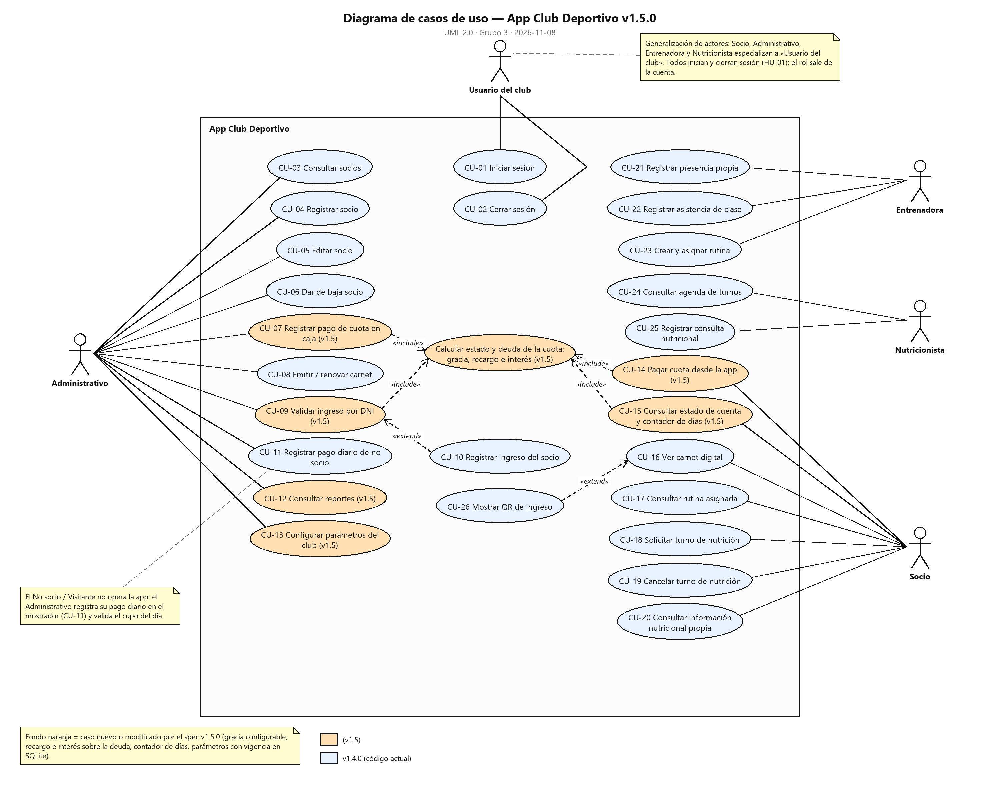

Los casos con fondo naranja son nuevos o cambian con el spec v1.5.0. «Calcular estado y deuda de la cuota» es el caso incluido por CU-07, CU-09, CU-14 y CU-15; CU-10 extiende a CU-09 cuando el resultado es «Permitido» y CU-26 (QR de ingreso) extiende a CU-16 (carnet digital).

### 3.1 Resumen de casos de uso

| CU | Nombre | Actor principal | HU | Pantalla |
|---|---|---|---|---|
| CU-01 | Iniciar sesión | Usuario del club | HU-01 | PantallaLogin (LoginActivity) → Activity del rol |
| CU-02 | Cerrar sesión | Usuario del club | HU-01 | PantallaPerfil (hoja de confirmación) |
| CU-03 | Consultar socios (búsqueda, filtros y ficha) | Administrativo | HU-02, HU-05, HU-14 | PantallaSocios → PantallaFichaSocio |
| CU-04 | Registrar socio | Administrativo | HU-02 | PantallaAlta (E_ALTA, «Alta de socio») |
| CU-05 | Editar socio | Administrativo | HU-02 (CRUD) | PantallaAlta en modo edición (E_EDITAR, «Editar socio») |
| CU-06 | Dar de baja socio | Administrativo | HU-02 (CRUD) | PantallaFichaSocio (hoja «Dar de baja») |
| CU-07 | Registrar pago de cuota en caja | Administrativo | HU-04 | PantallaFichaSocio (hoja «Registrar pago») |
| CU-08 | Emitir / renovar carnet | Administrativo | HU-07 | PantallaFichaSocio (hoja «Renovar carnet» / «Reemitir carnet») |
| CU-09 | Validar ingreso por DNI (control de acceso) | Administrativo | HU-05 | PantallaAcceso |
| CU-10 | Registrar ingreso del socio («extend» de CU-09) | Administrativo | HU-05 | PantallaAcceso (resultado «Permitido») |
| CU-11 | Registrar pago diario de no socio | Administrativo | HU-03 | PantallaVisitantes → PantallaVisitanteNuevo («Ingreso de visitante») |
| CU-12 | Consultar reportes | Administrativo | HU-14 | PantallaReportes |
| CU-13 | Configurar parámetros del club (v1.5) | Administrativo | Regla de negocio de HU-04 y HU-05 (sin HU nueva; ver «A confirmar») | PantallaPerfil → sección «Configuración del club» |
| CU-14 | Pagar cuota desde la app | Socio | HU-04 | PantallaSocioHome / PantallaCuotas → PantallaPagar → PantallaPagoOk |
| CU-15 | Consultar estado de cuenta, deuda y contador de días | Socio | HU-04 | PantallaSocioHome, PantallaCuotas («Estado de cuenta») |
| CU-16 | Ver carnet digital | Socio | HU-06 | PantallaCarnet (S_CARNET) |
| CU-17 | Consultar rutina asignada | Socio | HU-10 | PantallaRutinaSocio (y tarjeta «Rutina · hoy» del Inicio) |
| CU-18 | Solicitar turno de nutrición | Socio | HU-11 | PantallaNutriSocio → PantallaTurno («Solicitar turno») |
| CU-19 | Cancelar turno de nutrición | Socio | HU-11 | PantallaNutriSocio (hoja «Cancelar turno») |
| CU-20 | Consultar información nutricional propia | Socio | HU-13 | PantallaNutriSocio |
| CU-21 | Registrar presencia propia | Entrenadora | HU-08 | PantallaProfesorHome |
| CU-22 | Registrar asistencia de clase | Entrenadora | HU-08 | PantallaProfesorHome → PantallaAsistencia |
| CU-23 | Crear y asignar rutina | Entrenadora | HU-09 | PantallaRutinasProfesor → PantallaRutinaEdit («Rutina del socio») |
| CU-24 | Consultar agenda de turnos | Nutricionista | HU-11 | PantallaAgenda |
| CU-25 | Registrar consulta nutricional (ficha nutricional) | Nutricionista | HU-12 | PantallaFichas → PantallaFichaNutricional |
| CU-26 | Mostrar QR de ingreso («extend» de CU-16) | Socio | HU-06 | PantallaCarnet → PantallaQrIngreso (S_QR, «QR de ingreso») |

## 4. Especificación de los casos de uso (plantilla única, con su diagrama de secuencia)

### CU-01 — Iniciar sesión

| Campo | Detalle |
|---|---|
| ID | CU-01 |
| Nombre | Iniciar sesión |
| Actor principal | Usuario del club (Socio, Administrativo, Entrenadora, Nutricionista) |
| Actores secundarios / participantes | Pantalla: PantallaLogin (LoginActivity). Participantes: ClubViewModel, ClubRepositorio, ClubDbHelper (SQLite, tabla usuario), Activity del rol (SocioActivity, AdminActivity, EntrenadoraActivity, NutricionistaActivity). |
| HU relacionada | HU-01 |
| Pantalla(s) | PantallaLogin (LoginActivity) → Activity del rol |
| Precondiciones | La app está abierta sin sesión. La cuenta existe en la tabla usuario (semilla: Andres/Socio123, Jorge/Admin123, Ana/Prof123, Leandro/Nut123). |
| Disparador | El usuario toca «Iniciar sesión» (login()). |
| Flujo principal | 1. El usuario escribe usuario y contraseña (o toca una de las «Cuentas de prueba», que completa el formulario). 2. Toca «Iniciar sesión» (login()). 3. El sistema verifica alias normalizado y clave contra la tabla usuario (ClubRepositorio.autenticar → ClubDbHelper.autenticar). 4. Deduce el rol de la cuenta; no hay selector de perfil. 5. Guarda rol y pila en el estado (se persiste en la tabla sesion); LoginActivity abre la Activity del rol (abrirActivityDelRol) en su pantalla raíz: Inicio para Socio, Administrativo y Entrenadora; Agenda para la Nutricionista. Los campos de usuario y clave se limpian. |
| Flujos alternativos y de excepción | 2a. Alias o contraseña vacíos → mensaje «Completá usuario y contraseña.»; permanece en el login. 3a. Credenciales inválidas → «Usuario o contraseña incorrectos.»; loginError = true. 3b. La cuenta es de un socio dado de baja (CU-06) → el ingreso se rechaza con el mismo mensaje. |
| Postcondiciones | Sesión iniciada con el rol de la cuenta (tabla sesion); se muestra la barra inferior del rol. |
| Reglas de negocio | RN1. El rol sale de la cuenta (tabla usuario); no hay selector de perfil. RN2. El alias se normaliza (sin tildes ni mayúsculas) antes de compararlo. RN3. Un socio dado de baja pierde el acceso (dadoDeBaja). |
| Datos de demo para probarlo | Socio: Andres / Socio123 · Administrativo: Jorge / Admin123 · Entrenadora: Ana / Prof123 · Nutricionista: Leandro / Nut123. Para el error: Andres / incorrecta → «Usuario o contraseña incorrectos.» |
| Diagrama | Diagrama de secuencia UML 2.0 de CU-01 (diagramas/sec_cu01_iniciar_sesion.png), en la figura siguiente |

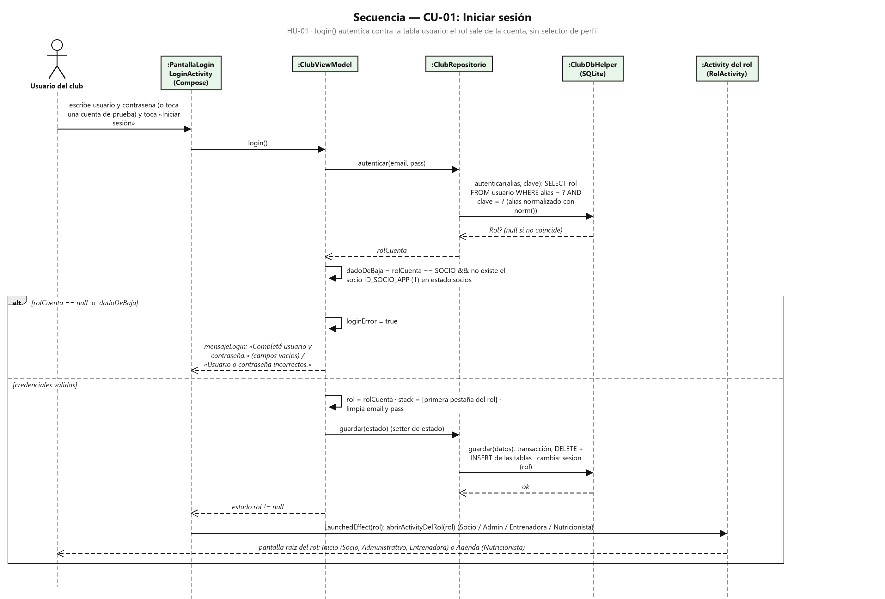

### CU-02 — Cerrar sesión

| Campo | Detalle |
|---|---|
| ID | CU-02 |
| Nombre | Cerrar sesión |
| Actor principal | Usuario del club |
| Actores secundarios / participantes | Pantalla: PantallaPerfil con HojaCerrarSesion. Participantes: ClubViewModel, ClubRepositorio, ClubDbHelper (tabla sesion), LoginActivity. |
| HU relacionada | HU-01 |
| Pantalla(s) | PantallaPerfil (hoja de confirmación) |
| Precondiciones | Sesión iniciada. |
| Disparador | El usuario toca «Cerrar sesión» en Perfil (pedirCerrarSesion()). |
| Flujo principal | 1. El usuario abre Perfil (pestaña para Socio, Entrenadora y Nutricionista; desde el avatar para el Administrativo) y toca «Cerrar sesión» (pedirCerrarSesion()). 2. El sistema muestra la hoja de confirmación. 3. El usuario confirma (cerrarSesion()). 4. El sistema descarta el rol y la pila de pantallas y vuelve a LoginActivity. |
| Flujos alternativos y de excepción | 3a. Cancela → se cierra la hoja y sigue en Perfil (cancelarCerrarSesion()). |
| Postcondiciones | Sin sesión. Los datos persistidos en SQLite no cambian. |
| Reglas de negocio | RN1. Se pide confirmación antes de cerrar. RN2. Los datos del club no se tocan; solo se descarta el rol y la pila de pantallas. |
| Datos de demo para probarlo | Cualquier cuenta de CU-01 (por ejemplo Jorge / Admin123): Perfil → Cerrar sesión → confirmar. |
| Diagrama | Diagrama de secuencia UML 2.0 de CU-02 (diagramas/sec_cu02_cerrar_sesion.png), en la figura siguiente |

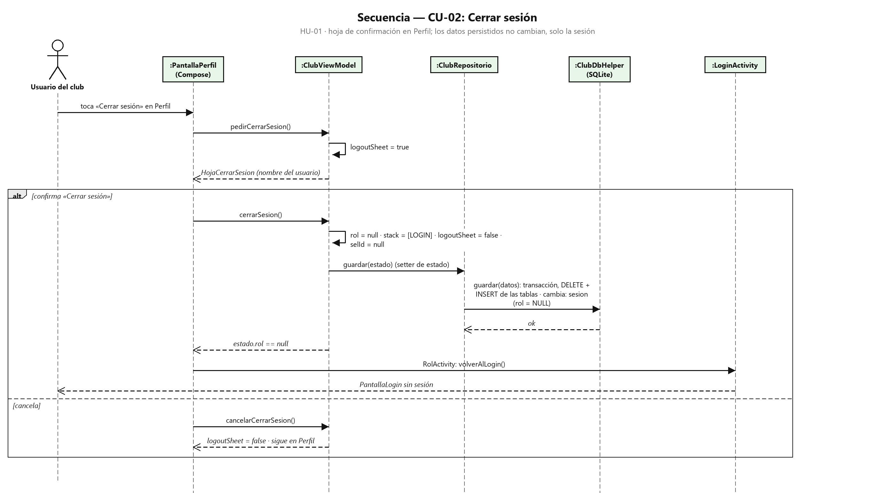

### CU-03 — Consultar socios (búsqueda, filtros y ficha)

| Campo | Detalle |
|---|---|
| ID | CU-03 |
| Nombre | Consultar socios (búsqueda, filtros y ficha) |
| Actor principal | Administrativo |
| Actores secundarios / participantes | Pantallas: PantallaSocios, PantallaFichaSocio. Participantes: ClubViewModel, SocioVista (etiquetas de estado, contador, deuda). |
| HU relacionada | HU-02, HU-05, HU-14 |
| Pantalla(s) | PantallaSocios → PantallaFichaSocio |
| Precondiciones | Sesión de Administrativo. |
| Disparador | El Administrativo abre la pestaña Socios. |
| Flujo principal | 1. Abre la pestaña Socios. 2. El sistema lista el padrón leído de SQLite con la etiqueta de estado de cada socio (v1.5: «Habilitado · En período de gracia», «Habilitado · Cuota pendiente», «Habilitado · Cuota al día», «No habilitado · En mora», «No habilitado · Carnet vencido») y el contador de días con su tono verde / naranja / rojo. 3. Puede escribir en la búsqueda (nombre o DNI, con o sin puntos) y elegir el filtro Todos / Habilitados / En mora (elegirFiltro()). 4. Toca un socio (abrirSocio()) y el sistema muestra la ficha: datos, N° de socio, plan, carnet (emitido / vence / estado), cuota vigente con vencimiento, historial de pagos con comprobantes, actividades, ingresos, ficha médica; (v1.5) el aviso de habilitación lleva a la derecha la cápsula estadoCorto («Debe $…», «Quedan N días», «Vence en N días», «Al día», «Renovar carnet»), la tarjeta de la cuota muestra el contador en cápsula (contadorCorto) y una línea cuotaSubLabel con la fecha, y el total adeudado con el detalle cuota + recargo + interés si la cuota venció. |
| Flujos alternativos y de excepción | 3a. La búsqueda o el filtro no coinciden con nadie → «Ningún socio coincide con la búsqueda.» |
| Postcondiciones | Ninguna modificación. Desde la ficha se accede a CU-05, CU-06, CU-07 y CU-08. |
| Reglas de negocio | RN1. Habilitado = no está en mora y el carnet no venció (SocioVista.hab). RN2. La búsqueda acepta nombre o DNI con o sin puntos. RN3. El filtro «En mora» usa SocioVista.mora (d > gracia), no el estado guardado. |
| Datos de demo para probarlo | Jorge / Admin123. Buscar «39876540» → Rocío Paz (En período de gracia). Filtro «En mora» → Lucas Benítez y Tomás Giménez. Buscar «zzz» → «Ningún socio coincide con la búsqueda.» |
| Diagrama | Diagrama de secuencia UML 2.0 de CU-03 (diagramas/sec_cu03_consultar_socios.png), en la figura siguiente |

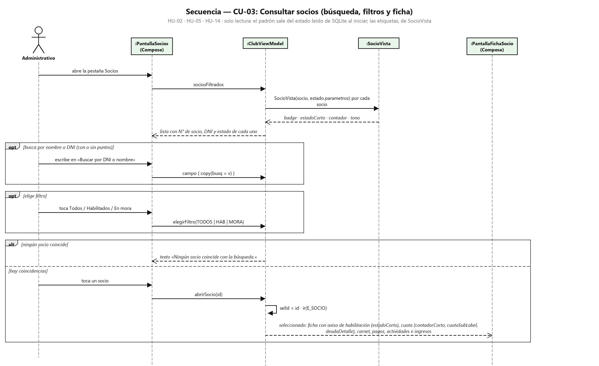

### CU-04 — Registrar socio

| Campo | Detalle |
|---|---|
| ID | CU-04 |
| Nombre | Registrar socio |
| Actor principal | Administrativo |
| Actores secundarios / participantes | Pantalla: PantallaAlta (E_ALTA). Participantes: ClubViewModel, Validaciones, ClubRepositorio (contarDni), ClubDbHelper (SQLite: socio, carnet, cuota). |
| HU relacionada | HU-02 |
| Pantalla(s) | PantallaAlta (E_ALTA, «Alta de socio») |
| Precondiciones | Sesión de Administrativo. El DNI a registrar no pertenece a otro socio. |
| Disparador | El Administrativo toca «Registrar socio» (Inicio o «+ Alta» en Socios). |
| Flujo principal | 1. Desde Inicio toca «Registrar socio» (irAAlta()): formulario limpio, plan «Full» por defecto, apto físico activo. 2. Completa nombre, apellido (v1.5: campo aparte), DNI, correo, plan (Básico $12.000 / Full $18.500 / Familiar $29.000), apto físico y observaciones. 3. Toca «Registrar socio» (confirmarAlta()). 4. El sistema valida en orden: nombre, apellido (v1.5), DNI (formato), DNI único (COUNT en SQLite), correo. 5. Genera el N° de socio (1500 + cantidad de socios; si ese número ya existe por una baja, el siguiente libre), emite el carnet (hoy → hoy + 12 meses − 1 día) y crea la cuota inicial PENDIENTE (precio del plan, vence hoy + 10 días) y la ficha nutricional inicial. 6. Agrega el socio al padrón y lo guarda en SQLite; navega a Socios → Ficha del socio con el toast «Socio N° xxxxx registrado · carnet y cuota inicial generados». |
| Flujos alternativos y de excepción | 4a. Nombre vacío → «Ingresá el nombre.»; con caracteres no permitidos → «El nombre solo puede contener letras y espacios.»; menos de 2 letras → «El nombre es demasiado corto.» 4b. Apellido: «Ingresá el apellido.» / «El apellido solo puede contener letras y espacios.» / «El apellido es demasiado corto.» 4c. DNI vacío → «Ingresá el DNI.»; con letras → «El DNI solo puede contener números.»; distinto de 7 u 8 dígitos → «El DNI debe tener 7 u 8 dígitos.» 4d. Correo vacío → «Ingresá el correo electrónico.»; formato inválido → «El correo electrónico no tiene un formato válido (ej.: nombre@dominio.com).» 4e. DNI ya registrado (COUNT en SQLite) → «Ya existe un socio con ese DNI.» En todos los casos el error se muestra bajo el formulario (altaError) y se permanece en «Alta de socio». |
| Postcondiciones | Socio persistido (tablas socio, carnet, cuota) con N° único, carnet vigente 12 meses, cuota inicial pendiente, sin rutina ni turno, IMC «—»; nace habilitado. |
| Reglas de negocio | RN1. Validaciones en orden: nombre, apellido, DNI (7 u 8 dígitos), correo y DNI único. RN2. N° de socio = 1500 + cantidad de socios, o el siguiente libre. RN3. Carnet por 12 meses; cuota inicial al precio del plan con vencimiento a 10 días. RN4. Planes: Básico $12.000, Full $18.500, Familiar $29.000. |
| Datos de demo para probarlo | Jorge / Admin123. Alta válida: nombre «Paula», apellido «Gómez», DNI 30111222, correo paula.gomez@club.com, plan Full. DNI duplicado: 38412907 (Andrés) → «Ya existe un socio con ese DNI.» |
| Diagrama | Diagrama de secuencia UML 2.0 de CU-04 (diagramas/sec_cu04_registrar_socio.png), en la figura siguiente |

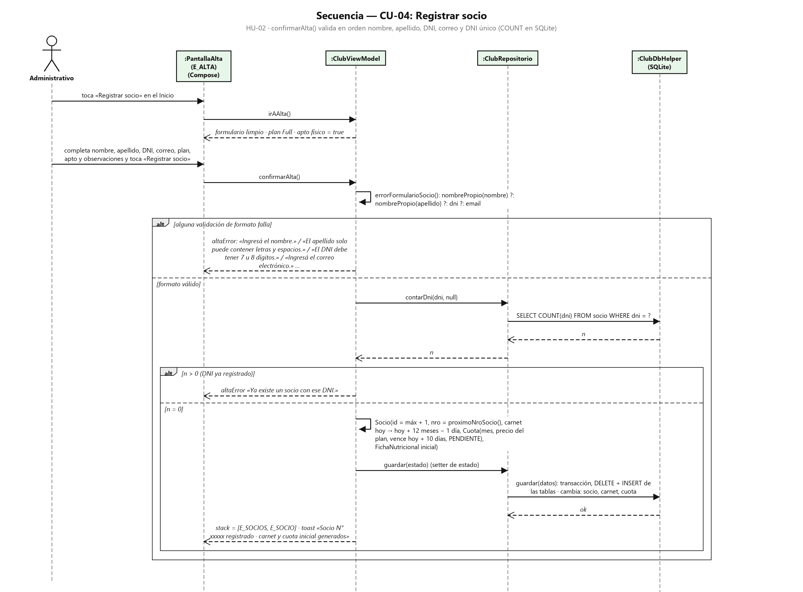

### CU-05 — Editar socio

| Campo | Detalle |
|---|---|
| ID | CU-05 |
| Nombre | Editar socio |
| Actor principal | Administrativo |
| Actores secundarios / participantes | Pantalla: PantallaAlta en modo edición (E_EDITAR). Participantes: ClubViewModel, ClubRepositorio (contarDni con exceptoId), ClubDbHelper (SQLite: socio). |
| HU relacionada | HU-02 (CRUD) |
| Pantalla(s) | PantallaAlta en modo edición (E_EDITAR, «Editar socio») |
| Precondiciones | Ficha de un socio abierta (CU-03). |
| Disparador | El Administrativo toca «Editar datos» en la ficha (irAEditar()). |
| Flujo principal | 1. Toca «Editar datos» (irAEditar()). 2. El sistema precarga nombre (v1.5: nombre y apellido partidos en el primer espacio), DNI, correo, plan, apto físico y observaciones. 3. Modifica los datos y toca «Guardar cambios» (confirmarAlta() → guardarEdicion()). 4. El sistema valida igual que el alta; el DNI puede coincidir con el del propio socio (contarDni excluye su id). 5. Guarda nombre, DNI, correo, plan, apto físico y antecedentes; vuelve a la ficha con el toast «Datos del socio actualizados». |
| Flujos alternativos y de excepción | 4a. Cualquier validación falla → altaError bajo el formulario; permanece en «Editar socio». |
| Postcondiciones | Cambios persistidos en SQLite. El cambio de plan rige desde la próxima cuota: la cuota emitida, el carnet y el historial no se modifican. |
| Reglas de negocio | RN1. Mismas validaciones que el alta; el DNI puede ser el del propio socio. RN2. El cambio de plan rige desde la próxima cuota; la cuota emitida, el carnet y el historial no cambian. |
| Datos de demo para probarlo | Jorge / Admin123 → Socios → Camila Duarte → «Editar datos»: cambiar plan a Básico y guardar. Para el error, poner el DNI 38412907 (de Andrés). |
| Diagrama | Diagrama de secuencia UML 2.0 de CU-05 (diagramas/sec_cu05_editar_socio.png), en la figura siguiente |

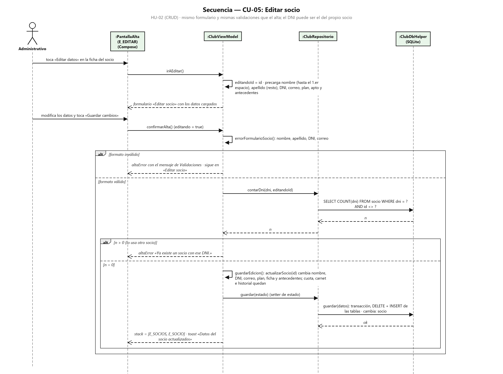

### CU-06 — Dar de baja socio

| Campo | Detalle |
|---|---|
| ID | CU-06 |
| Nombre | Dar de baja socio |
| Actor principal | Administrativo |
| Actores secundarios / participantes | Pantalla: PantallaFichaSocio (HojaConfirmacion). Participantes: ClubViewModel, ClubRepositorio, ClubDbHelper (SQLite: socio con ON DELETE CASCADE a carnet, cuota y pago). |
| HU relacionada | HU-02 (CRUD) |
| Pantalla(s) | PantallaFichaSocio (hoja «Dar de baja») |
| Precondiciones | Ficha de un socio abierta. |
| Disparador | El Administrativo toca «Dar de baja» en la ficha (pedirBajaSocio()). |
| Flujo principal | 1. Toca «Dar de baja» (pedirBajaSocio()). 2. El sistema muestra la hoja con Socio, DNI y N° de socio y la advertencia de que la acción no se puede deshacer. 3. Confirma «Confirmar baja». 4. El sistema quita al socio del padrón, de los inscriptos de las actividades y de las asistencias; vuelve a Socios con el toast «{nombre} dado de baja». |
| Flujos alternativos y de excepción | 3a. Cancela → se cierra la hoja y el socio sigue en el padrón. |
| Postcondiciones | Filas eliminadas en SQLite (carnet, cuota y pagos por ON DELETE CASCADE). Si era el socio de la cuenta de la app, esa cuenta ya no puede iniciar sesión (CU-01, 3b). El N° del próximo alta no repite ninguno existente. |
| Reglas de negocio | RN1. La baja pide confirmación y no se puede deshacer. RN2. Quita al socio del padrón, de los inscriptos de las actividades y de las asistencias. RN3. La cuenta de app del socio (id 1) deja de poder iniciar sesión. |
| Datos de demo para probarlo | Jorge / Admin123 → Socios → Camila Duarte (DNI 43.210.987) → «Dar de baja» → «Confirmar baja». |
| Diagrama | Diagrama de secuencia UML 2.0 de CU-06 (diagramas/sec_cu06_baja_socio.png), en la figura siguiente |

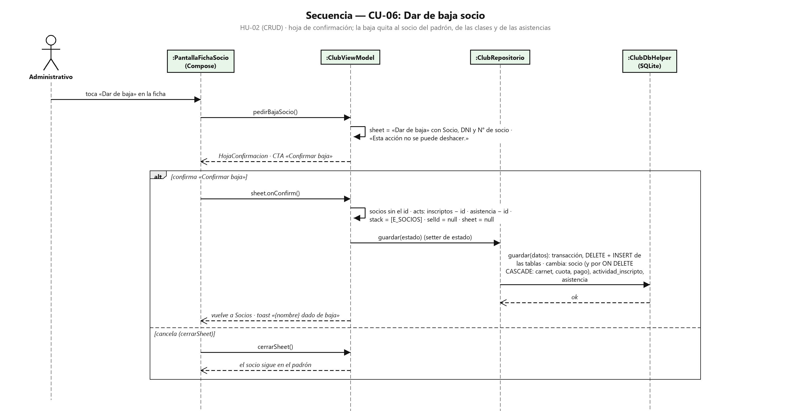

### CU-07 — Registrar pago de cuota en caja

| Campo | Detalle |
|---|---|
| ID | CU-07 |
| Nombre | Registrar pago de cuota en caja |
| Actor principal | Administrativo |
| Actores secundarios / participantes | Pantalla: PantallaFichaSocio (hoja «Registrar pago»). Participantes: ClubViewModel, SocioVista (totalAdeudado), ClubRepositorio, ClubDbHelper (SQLite: cuota, pago). |
| HU relacionada | HU-04 |
| Pantalla(s) | PantallaFichaSocio (hoja «Registrar pago») |
| Precondiciones | Ficha de un socio abierta; la cuota vigente no está pagada. |
| Disparador | El Administrativo toca «Registrar pago en caja» (pedirRegistrarPago()). |
| Flujo principal | 1. Toca «Registrar pago en caja» (pedirRegistrarPago()). 2. El sistema verifica seleccionado.cuotaPagada; si no está pagada, toma el importe de SocioVista(socio, parametros).totalAdeudado: la cuota si no venció; cuota + recargo vigente hoy (una vez) + interés (por cada día desde el vencimiento, cuota × interés mensual vigente ese día / 100 / 30) si venció, en gracia o en mora. 3. Muestra la hoja «Registrar pago» con Socio, Cuota (mes) e Importe (el total) y el botón «Cobrar $total»; el detalle «Cuota $x + recargo $y + interés $z» se ve en la tarjeta de la cuota de la ficha (deudaDetalle). 4. Confirma. Se ejecuta pagarCuota(id, «Caja»): la cuota pasa a PAGADA, proximaVence = vence + 1 mes y se antepone PagoHistorial(mes, total, hoy, «Caja», comprobante «CD-2609-####»). 5. El setter de estado guarda en SQLite (cuota, pago), se cierra la hoja y aparece «Pago registrado · socio habilitado». |
| Flujos alternativos y de excepción | 1a. La cuota ya está pagada → toast «La cuota de {mes} ya está pagada.» y la hoja no se abre (una cuota no se cobra dos veces). 4a. Cancela la hoja → nada cambia. |
| Postcondiciones | Cuota pagada con comprobante; el socio queda habilitado si su carnet está vigente; sale de los listados «Vencen hoy» y «En mora». Al reabrir la app, completarCuotasSiguientes() crea la cuota del mes siguiente. |
| Reglas de negocio | RN1. Una cuota pagada no se cobra dos veces. RN2. totalAdeudado = cuota + recargo (una vez, si venció) + interés diario con la tasa vigente cada día / 30. RN3. Recargo e interés se deben desde el vencimiento, también dentro de la gracia; no son retroactivos. RN4. El comprobante es «CD-2609-» + 4 dígitos; el historial guarda monto = total cobrado. |
| Datos de demo para probarlo | Jorge / Admin123. Lucas Benítez (40.120.334): cuota $12.000 vencida hace 29 días → $12.848 (recargo $500 + interés $348). Rocío Paz (39.876.540, en gracia): $12.536. Camila Duarte (cuota pagada) → «La cuota de {mes} ya está pagada.» |
| Diagrama | Diagrama de secuencia UML 2.0 de CU-07 (diagramas/sec_cu07_cobro_caja.png), en la figura siguiente |

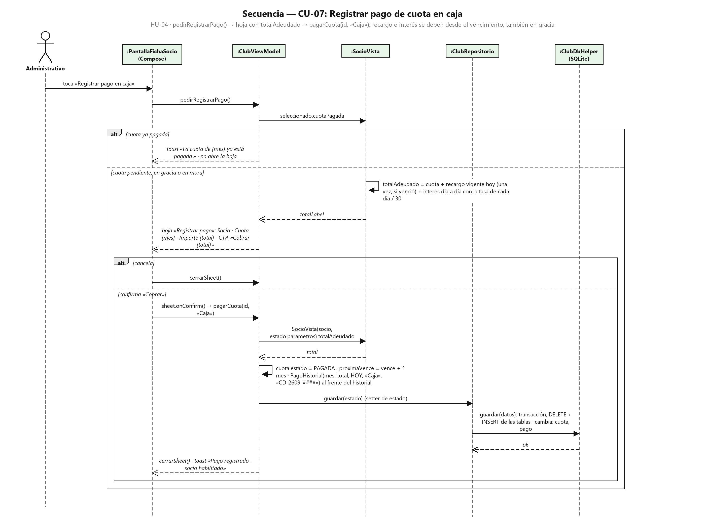

### CU-08 — Emitir / renovar carnet

| Campo | Detalle |
|---|---|
| ID | CU-08 |
| Nombre | Emitir / renovar carnet |
| Actor principal | Administrativo |
| Actores secundarios / participantes | Pantalla: PantallaFichaSocio (hoja «Renovar carnet» / «Reemitir carnet»). Participantes: ClubViewModel, SocioVista (carnetAccion), ClubRepositorio, ClubDbHelper (SQLite: carnet). |
| HU relacionada | HU-07 |
| Pantalla(s) | PantallaFichaSocio (hoja «Renovar carnet» / «Reemitir carnet») |
| Precondiciones | Ficha de un socio abierta. |
| Disparador | El Administrativo toca la acción del carnet en la ficha (pedirRenovarCarnet()). |
| Flujo principal | 1. Toca la acción del carnet (pedirRenovarCarnet()); el título es «Renovar carnet» si venció o «Reemitir carnet» si está vigente. 2. El sistema muestra la hoja con Socio y «Nueva vigencia»: hoy → hoy + 12 meses − 1 día. 3. Confirma «Emitir carnet». 4. El sistema actualiza carnetEmitido y carnetVence y muestra «Carnet emitido · vigente hasta dd/mm/aaaa». |
| Flujos alternativos y de excepción | 3a. Cancela → el carnet no cambia. |
| Postcondiciones | Carnet vigente 12 meses persistido (tabla carnet). Si el socio estaba bloqueado solo por carnet vencido, queda habilitado; el carnet digital del socio (CU-16) muestra la nueva vigencia. |
| Reglas de negocio | RN1. Siempre 12 meses: de hoy a hoy + 12 meses − 1 día. RN2. Título «Renovar carnet» si venció, «Reemitir carnet» si está vigente. |
| Datos de demo para probarlo | Jorge / Admin123 → Socios → Sofía Acosta (35.887.210, carnet vencido hace 8 días) → «Renovar carnet» → «Emitir carnet». |
| Diagrama | Diagrama de secuencia UML 2.0 de CU-08 (diagramas/sec_cu08_carnet.png), en la figura siguiente |

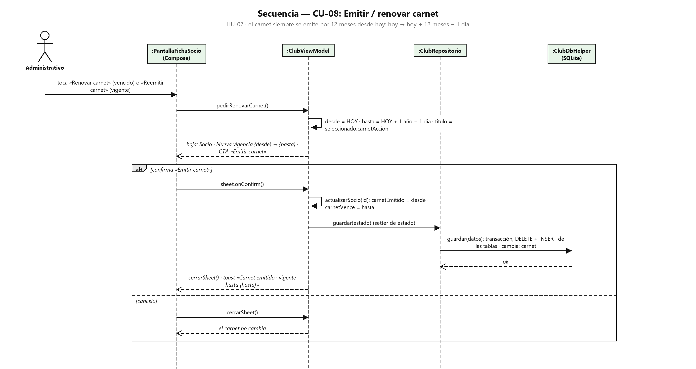

### CU-09 — Validar ingreso por DNI (control de acceso)

| Campo | Detalle |
|---|---|
| ID | CU-09 |
| Nombre | Validar ingreso por DNI (control de acceso) |
| Actor principal | Administrativo |
| Actores secundarios / participantes | Pantalla: PantallaAcceso. Participantes: ClubViewModel (validarAcceso), Validaciones, SocioVista (hab, enGracia, mora, totalAdeudado). No consulta SQLite: el padrón y los parámetros ya están en el estado. |
| HU relacionada | HU-05 |
| Pantalla(s) | PantallaAcceso |
| Precondiciones | Sesión de Administrativo. |
| Disparador | El Administrativo toca «Validar» (validarAcceso()) o un DNI de prueba (ponerDniAcceso()). |
| Flujo principal | 1. Escribe el DNI (con o sin puntos) y toca «Validar» (validarAcceso()), o toca un DNI de la fila «Probar:» (ponerDniAcceso()). 2. El sistema valida el formato del DNI (Validaciones.dni). 3. Busca el socio por DNI en el padrón del estado y arma SocioVista(socio, parametros) con los parámetros vigentes (sin consultar SQLite). 4. Si el socio está habilitado, muestra «Permitido» (verde): con cuota pagada «Carnet vigente y cuota al día.»; con cuota pendiente «Carnet vigente · cuota {mes} pendiente, vence en N días.» (o «vence hoy»). 5. La tarjeta de resultado ofrece «Ver ficha» y, si es Permitido y aún no se registró, «Registrar ingreso» (CU-10). |
| Flujos alternativos y de excepción | 2a. DNI inválido → toast con el mensaje de validación («Ingresá el DNI.», «El DNI solo puede contener números.», «El DNI debe tener 7 u 8 dígitos.») y sin resultado. 3a. No hay socio con ese DNI → «No encontrado»: «No hay ningún socio con DNI xx.xxx.xxx. Podés registrarlo como visitante o dar de alta un socio.»; la tarjeta ofrece el botón «Registrar socio» (CU-04). 4a. (v1.5) 0 < d <= gracia → «Permitido» (naranja): «Cuota {mes} vencida · quedan N días de gracia. Debe $total en recepción.» (o «queda 1 día de gracia», «último día de gracia»). 4b. (v1.5) d > gracia → «Denegado» (rojo): «Cuota {mes} en mora: vencida hace N días · gracia de G días superada. Debe $total en recepción.» 4c. Carnet vencido (sin mora) → «Denegado»: «Carnet vencido el dd/mm/aaaa. Debe renovarse.» (CU-08). Si además hay mora, prevalece el mensaje de mora. |
| Postcondiciones | Resultado en pantalla; nada se persiste hasta CU-10. |
| Reglas de negocio | RN1. hab = no está en mora y el carnet no venció. RN2. Con la cuota vencida: d <= gracia → Permitido con aviso (naranja); d > gracia → Denegado por mora (rojo). RN3. Si coinciden mora y carnet vencido, el mensaje es el de la mora. RN4. La gracia es la vigente hoy (CU-13). |
| Datos de demo para probarlo | Jorge / Admin123 → Acceso, botones «Probar»: 38.412.907 Al día (Permitido) · 40.120.334 En mora (Denegado) · 39.876.540 En gracia (Permitido, naranja, debe $12.536) · 35.887.210 Carnet vencido (Denegado) · 11.111.111 No existe. |
| Diagrama | Diagrama de secuencia UML 2.0 de CU-09 (diagramas/sec_cu09_validar_acceso.png), en la figura siguiente |

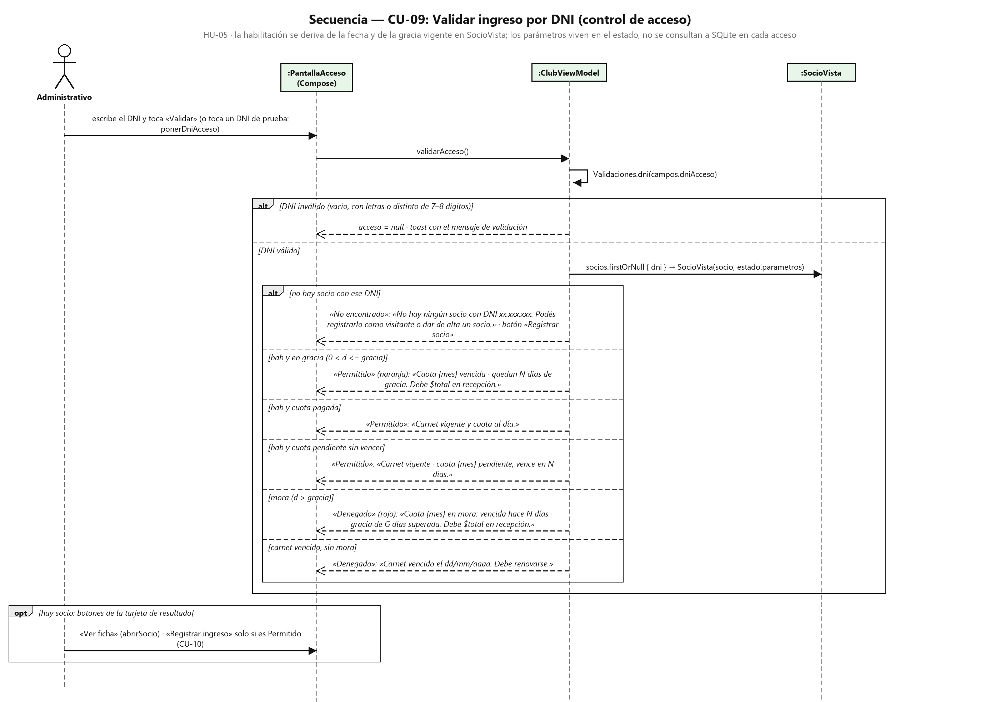

### CU-10 — Registrar ingreso del socio («extend» de CU-09)

| Campo | Detalle |
|---|---|
| ID | CU-10 |
| Nombre | Registrar ingreso del socio («extend» de CU-09) |
| Actor principal | Administrativo |
| Actores secundarios / participantes | Pantalla: PantallaAcceso (resultado «Permitido»). Participantes: ClubViewModel, ClubRepositorio, ClubDbHelper (SQLite: ingreso_hoy, socio.ingresos_json). |
| HU relacionada | HU-05 |
| Pantalla(s) | PantallaAcceso (resultado «Permitido») |
| Precondiciones | Resultado «Permitido» de CU-09 todavía no registrado. |
| Disparador | El Administrativo toca «Registrar ingreso» (registrarIngreso()). |
| Flujo principal | 1. Toca «Registrar ingreso» (registrarIngreso()). 2. El sistema antepone IngresoHoy(hora actual, nombre, «Permitido») a los ingresos del día y Ingreso(fecha · hora, «Permitido») al historial del socio; marca acceso.registrado = true. 3. Guarda en SQLite (ingreso_hoy, ingresos_json) y muestra «Ingreso registrado · {nombre}». |
| Flujos alternativos y de excepción | 1a. El ingreso ya fue registrado para ese resultado → no se vuelve a registrar (registrado = true). |
| Postcondiciones | KPI «Ingresos de hoy» del Inicio +1; el ingreso figura en la ficha del socio. |
| Reglas de negocio | RN1. El botón solo aparece si el socio está habilitado y el ingreso aún no se registró. RN2. Un socio en gracia es habilitado: su ingreso se registra. |
| Datos de demo para probarlo | Jorge / Admin123 → Acceso → 38.412.907 (Andrés) → «Registrar ingreso» → «Ingreso registrado · Andrés Weitzel». Repetirlo: el botón ya no aparece. Con 40.120.334 (Lucas, Denegado) el botón no existe. |
| Diagrama | Diagrama de secuencia UML 2.0 de CU-10 (diagramas/sec_cu10_registrar_ingreso.png), en la figura siguiente |

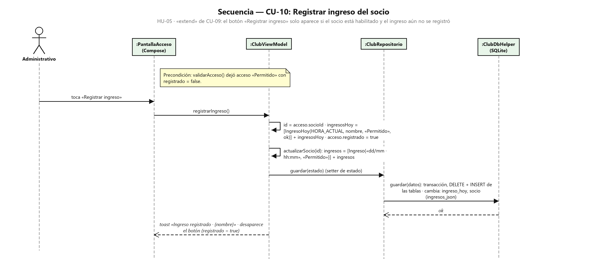

### CU-11 — Registrar pago diario de no socio

| Campo | Detalle |
|---|---|
| ID | CU-11 |
| Nombre | Registrar pago diario de no socio |
| Actor principal | Administrativo (beneficiario: No socio / Visitante) |
| Actores secundarios / participantes | Pantallas: PantallaVisitantes, PantallaVisitanteNuevo. Participantes: ClubViewModel, ClubRepositorio (contarVisitante), ClubDbHelper (SQLite: visitante). Beneficiario: No socio / Visitante. |
| HU relacionada | HU-03 |
| Pantalla(s) | PantallaVisitantes → PantallaVisitanteNuevo («Ingreso de visitante») |
| Precondiciones | Sesión de Administrativo. Hay actividades con cupo del día. |
| Disparador | El Administrativo toca «Registrar visitante» (irAVisitanteNuevo()). |
| Flujo principal | 1. Desde Inicio («Registrar visitante») o desde Visitantes toca nuevo ingreso (irAVisitanteNuevo()): nombre y DNI vacíos, medio Efectivo, sin actividad. 2. Escribe nombre y apellido y DNI del visitante; elige la actividad (elegirActividadVisitante()) y el medio de pago (Efectivo / Débito). 3. El sistema muestra el cupo del día de cada actividad: libres = cupo − (ocupados + visitantes de hoy). 4. Toca «Registrar pago diario» (confirmarVisitante()). 5. El sistema valida nombre y DNI, la actividad y su cupo, y consulta en SQLite si ese DNI ya pagó hoy (contarVisitante(dni, HOY)). 6. Registra Visitante(nombre, DNI con puntos, actividad, hora actual, monto = precio de la actividad, fecha de hoy, medio), lo guarda (INSERT visitante), vuelve a Visitantes y muestra «Pago diario registrado · $precio». |
| Flujos alternativos y de excepción | 2a. La actividad elegida no tiene cupo → «{actividad} no tiene cupo disponible hoy (x/y). El ingreso no puede realizarse.» 5a. Nombre o DNI inválidos → visError con el mensaje de Validaciones («Ingresá nombre y apellido del visitante.», «El DNI debe tener 7 u 8 dígitos.», …). 5b. Sin actividad elegida → «Seleccioná una actividad.» 5c. Actividad sin cupo → «Sin cupo en {actividad}. El ingreso no puede realizarse.» 5d. El DNI ya tiene un pago diario hoy → «Ya hay un pago diario registrado hoy con el DNI xx.xxx.xxx.» |
| Postcondiciones | Pago diario persistido con fecha y medio; aparece en Visitantes (hoy) con el total del día y en Reportes → «Pagos diarios» por fecha (CU-12); el cupo del día baja en 1 y el KPI de ingresos de hoy sube en 1. |
| Reglas de negocio | RN1. Cupo del día = cupo − (ocupados + visitantes de hoy en esa actividad). RN2. Un solo pago diario por DNI y fecha. RN3. El monto es el precio de la actividad; el medio es Efectivo o Débito. |
| Datos de demo para probarlo | Jorge / Admin123. Natación está sin cupo (12/12) → error. Pedro Alonso, DNI 33.120.455, ya pagó hoy → «Ya hay un pago diario registrado hoy con el DNI 33.120.455.» Alta válida: «Sergio Lara», 31222333, Yoga, Efectivo → «Pago diario registrado · $5.000». |
| Diagrama | Diagrama de secuencia UML 2.0 de CU-11 (diagramas/sec_cu11_pago_diario.png), en la figura siguiente |

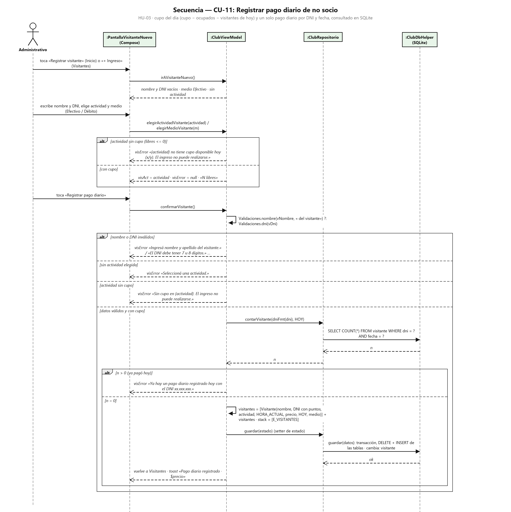

### CU-12 — Consultar reportes

| Campo | Detalle |
|---|---|
| ID | CU-12 |
| Nombre | Consultar reportes |
| Actor principal | Administrativo |
| Actores secundarios / participantes | Pantalla: PantallaReportes. Participantes: ClubViewModel, SocioVista (totalAdeudado), ClubRepositorio (idsCuotasPorVencer, visitantesPorFecha), ClubDbHelper (SQLite: cuota, socio, visitante). |
| HU relacionada | HU-14 |
| Pantalla(s) | PantallaReportes |
| Precondiciones | Sesión de Administrativo. |
| Disparador | El Administrativo abre la pestaña Reportes y elige una pestaña (elegirReportTab()). |
| Flujo principal | 1. Abre la pestaña Reportes. 2. Elige una pestaña (elegirReportTab()): «Vencen hoy» (cuotas PENDIENTES con vencimiento hoy, SELECT por rango en SQLite), «Esta semana» (de mañana a 7 días), «En mora» (socios en mora) o «Visitantes» (pagos diarios del día elegido). 3. El sistema muestra las filas ordenadas por vencimiento (o por hora) y «Total»: suma de cuotas, de totalAdeudado en «En mora», o de pagos diarios. 4. En «Visitantes» navega al día anterior / siguiente (diaReporteAnterior/Siguiente); no se puede avanzar más allá de hoy. 5. (v1.5) En «En mora» cada fila muestra el total adeudado y una línea «Rige: gracia … recargo … interés … desde dd/mm/aaaa. El total suma cuota, recargo e interés.»; tocar una fila abre la ficha. |
| Flujos alternativos y de excepción | 3a. Sin filas → «Sin registros en este reporte.» o «Sin pagos diarios el dd/mm/aaaa.»; total $0. |
| Postcondiciones | Ninguna modificación. Cobrar una cuota (CU-07) la saca de «Vencen hoy» y «En mora». |
| Reglas de negocio | RN1. «Vencen hoy»: cuotas PENDIENTES que vencen hoy; «Esta semana»: de mañana a 7 días. RN2. «En mora»: socios con mora; el total suma totalAdeudado. RN3. «Visitantes»: pagos diarios del día elegido; no se avanza más allá de hoy. |
| Datos de demo para probarlo | Jorge / Admin123 → Reportes. Vencen hoy: Martín Ledesma. Esta semana: Andrés Weitzel y Valentina Ruiz ($30.500). En mora: Lucas y Tomás. Visitantes: hoy $17.000 (3 pagos); día anterior $14.000. |
| Diagrama | Diagrama de secuencia UML 2.0 de CU-12 (diagramas/sec_cu12_reportes.png), en la figura siguiente |

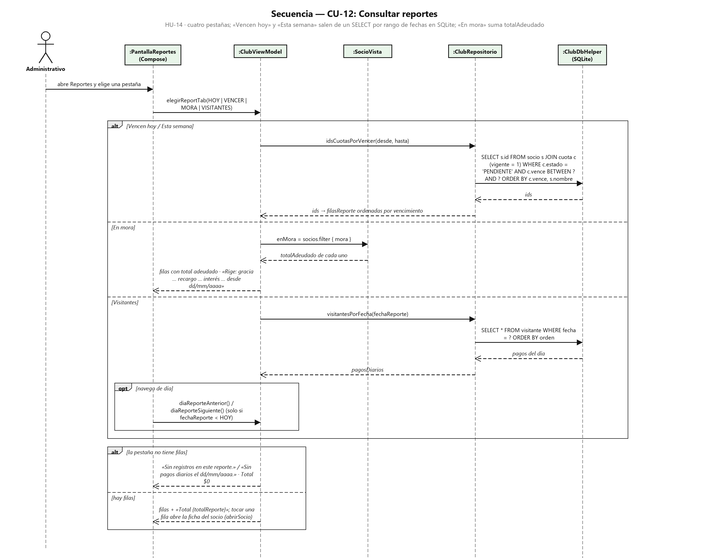

### CU-13 — Configurar parámetros del club (v1.5)

| Campo | Detalle |
|---|---|
| ID | CU-13 |
| Nombre | Configurar parámetros del club (v1.5) |
| Actor principal | Administrativo |
| Actores secundarios / participantes | Pantalla: PantallaPerfil (sección «Configuración del club», solo ADMIN). Participantes: ClubViewModel, ClubRepositorio, ClubDbHelper (SQLite versión 4: tabla parametro). |
| HU relacionada | Regla de negocio de HU-04 y HU-05 (sin HU nueva; ver «A confirmar») |
| Pantalla(s) | PantallaPerfil → sección «Configuración del club» |
| Precondiciones | Sesión de Administrativo. Base SQLite versión 4 con la tabla parametro; la semilla de la demo trae dos filas (desde hace un año: gracia 10 días, recargo $300, interés 2,5 %; desde hace dos meses: gracia 5, $500, 3 %). Si la tabla está vacía rige Parametros.INICIALES (5 / 0 / 0). |
| Disparador | El Administrativo toca «Guardar parámetros» (guardarParametros()). |
| Flujo principal | 1. Abre Perfil → «Configuración del club» (también desde la acción rápida «Parámetros del club» del Inicio). El sistema carga el formulario con los valores vigentes hoy (prepararParametros() → campos pGracia, pRecargo, pInteres) y muestra el historial por fecha, más nuevo primero (historialParametros). 2. Edita el período de gracia (días enteros, 0..60), el recargo (importe fijo en pesos, decimal, con coma o punto) y el interés mensual (%, 0..100) y toca «Guardar parámetros» (guardarParametros()). 3. El sistema valida y arma Parametros(gracia, recargo, interés, vigenteDesde = hoy); lo antepone a la lista del estado quitando cualquier otra fila de hoy (guardar dos veces el mismo día reemplaza la de hoy). 4. El setter de estado llama a ClubRepositorio.guardar → ClubDbHelper.guardar, que reescribe la tabla parametro (DELETE + INSERT de todas las filas, con orden) dentro de la transacción; toast «Parámetros guardados · rigen desde hoy». 5. Las SocioVista se recalculan con la lista nueva: estado derivado (pendiente / en gracia / mora), total adeudado y contador de todos los socios. |
| Flujos alternativos y de excepción | 3a. Gracia no entera o fuera de 0..60 → «La gracia debe ser un número entero de 0 a 60 días.» 3b. Recargo no numérico, no finito o fuera de 0..1.000.000 → «El recargo debe ser un importe de 0 a 1.000.000.» 3c. Interés no numérico o fuera de 0..100 → «El interés mensual debe ser un porcentaje de 0 a 100.» En los tres casos el error se muestra en el formulario (paramError) y no se guarda nada. |
| Postcondiciones | Los parámetros rigen desde hoy inclusive: List<Parametros>.vigenteEn(fecha) toma el más nuevo con vigenteDesde <= fecha; para fechas anteriores al primer parámetro guardado devuelve la gracia de la fila más antigua con recargo 0 e interés 0 (recargo e interés no se aplican hacia atrás). El interés se devenga día a día desde el vencimiento con la tasa que regía cada día; los días previos a que el administrador fijara la primera tasa no devengan nada. Tabla parametro(id, gracia_dias, recargo, interes_mensual, vigente_desde, orden), base versión 4; la lista vuelve a cargarse en ClubRepositorio.iniciar() → ClubDbHelper.leer() al abrir la app. |
| Reglas de negocio | RN1. Gracia entera 0..60; recargo 0..1.000.000; interés mensual 0..100 %. RN2. Cada guardado rige desde hoy; guardar dos veces el mismo día reemplaza la fila de hoy. RN3. No es retroactivo: antes del primer parámetro guardado no se devenga recargo ni interés. |
| Datos de demo para probarlo | Jorge / Admin123 → Inicio → «Parámetros del club». Valores de la demo: gracia 5 días, recargo $500, interés 3 % (vigente desde hace dos meses; antes 10 / $300 / 2,5 % desde hace un año). Error: gracia «x» → «La gracia debe ser un número entero de 0 a 60 días.» |
| Diagrama | Diagrama de secuencia UML 2.0 de CU-13 (diagramas/sec_cu13_parametros.png), en la figura siguiente |

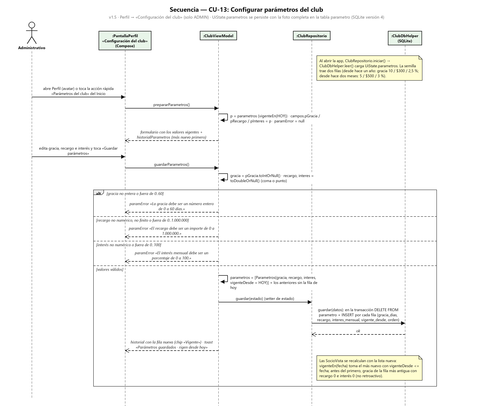

### CU-14 — Pagar cuota desde la app

| Campo | Detalle |
|---|---|
| ID | CU-14 |
| Nombre | Pagar cuota desde la app |
| Actor principal | Socio |
| Actores secundarios / participantes | Pantallas: PantallaSocioHome / PantallaCuotas → PantallaPagar → PantallaPagoOk. Participantes: ClubViewModel, SocioVista (totalAdeudado), ClubRepositorio, ClubDbHelper (SQLite: cuota, pago). |
| HU relacionada | HU-04 |
| Pantalla(s) | PantallaSocioHome / PantallaCuotas → PantallaPagar → PantallaPagoOk |
| Precondiciones | Sesión de Socio; la cuota vigente no está pagada. |
| Disparador | El Socio toca «Confirmar pago de $total» (confirmarPago()). |
| Flujo principal | 1. Toca «Pagar» en el Inicio o «Pagar cuota» en Estado de cuenta. 2. Elige el medio (elegirMedio()): Tarjeta de débito / crédito, Billetera virtual o Efectivo en el club (cupón para recepción). 3. (v1.5) El sistema muestra el importe total (totalAdeudado): cuota, más recargo e interés si la cuota ya venció (en gracia o en mora). 4. Toca «Confirmar pago de $total» (confirmarPago()). 5. El sistema ejecuta pagarCuota(socio de la app, medio): cuota PAGADA, proximaVence = vence + 1 mes, PagoHistorial con comprobante «CD-2609-####»; guarda en SQLite. 6. Reemplaza la pantalla de pago por «Pago OK» con el comprobante (sin barra inferior). |
| Flujos alternativos y de excepción | 4a. La cuota ya estaba pagada → toast «La cuota de {mes} ya está pagada.», no se registra otro pago ni se navega al comprobante. |
| Postcondiciones | Igual que CU-07. No hay pasarela de pago real: el pago se registra en la base, tal como define el diseño. |
| Reglas de negocio | RN1. Se cobra totalAdeudado (cuota más recargo e interés si venció). RN2. El pago se simula: no hay pasarela real. RN3. El botón «Pagar» solo aparece con la cuota pendiente; el ViewModel además rechaza una cuota ya pagada. |
| Datos de demo para probarlo | Andres / Socio123 (DNI 38.412.907): cuota Full $18.500 pendiente, vence en 2 días → Pagar → Tarjeta → «Confirmar pago de $18.500». |
| Diagrama | Diagrama de secuencia UML 2.0 de CU-14 (diagramas/sec_cu14_pagar_app.png), en la figura siguiente |

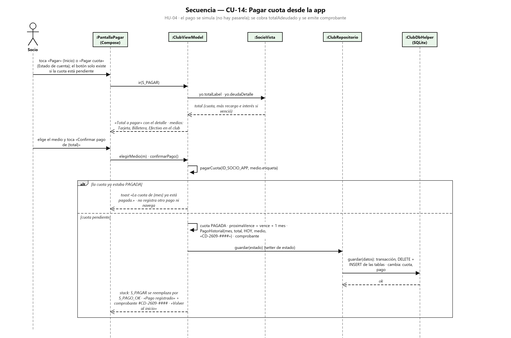

### CU-15 — Consultar estado de cuenta, deuda y contador de días

| Campo | Detalle |
|---|---|
| ID | CU-15 |
| Nombre | Consultar estado de cuenta, deuda y contador de días |
| Actor principal | Socio |
| Actores secundarios / participantes | Pantallas: PantallaSocioHome, PantallaCuotas («Estado de cuenta»). Participantes: ClubViewModel, SocioVista (badge, contadorCorto, cuotaSubLabel, deudaDetalle, totalLabel). |
| HU relacionada | HU-04 |
| Pantalla(s) | PantallaSocioHome, PantallaCuotas («Estado de cuenta») |
| Precondiciones | Sesión de Socio. |
| Disparador | El Socio abre el Inicio o «Ver estado de cuenta →». |
| Flujo principal | 1. En el Inicio el sistema muestra el aviso de habilitación (badge) y la tarjeta «Cuota {mes}»: cápsula contadorCorto, línea cuotaSubLabel, deudaDetalle si la cuota venció y el total (totalLabel) con el botón «Pagar» si está pendiente. 2. (v1.5) La cápsula cambia de tono: «Vence en N días» / «Vence hoy» (verde); «Quedan N días de gracia» / «Queda 1 día de gracia» / «Último día de gracia» (naranja); «Vencida hace N días» (rojo, con «Venció el … · gracia de G días superada»); «Pagada» con «Próxima cuota dd/mm/aaaa». 3. Si la cuota venció, el total adeudado lleva el detalle «Cuota $x + recargo $y + interés $z». 4. Toca «Ver estado de cuenta →» (PantallaCuotas): «Cuota actual», botón «Pagar cuota» si está pendiente y el Historial con «Pagada el … · medio · comprobante». |
| Flujos alternativos y de excepción | 2a. En mora el badge pasa a «No habilitado · En mora» y la cápsula a rojo hasta regularizar (CU-14 o CU-07). 4a. Sin pagos → «Sin pagos registrados.» |
| Postcondiciones | Ninguna modificación. |
| Reglas de negocio | RN1. Tono verde (OK), naranja (AVISO, en gracia) o rojo (BLOQUEO, mora). RN2. Si la cuota venció se muestra el total adeudado con el detalle cuota + recargo + interés. |
| Datos de demo para probarlo | Andres / Socio123: «Vence en 2 días». Para ver gracia y mora, entrar como Jorge y abrir las fichas de Rocío Paz («Quedan 2 días») y Lucas Benítez («Vencida hace 29 días»), que usan los mismos campos de SocioVista. |
| Diagrama | Diagrama de secuencia UML 2.0 de CU-15 (diagramas/sec_cu15_estado_cuenta.png), en la figura siguiente |

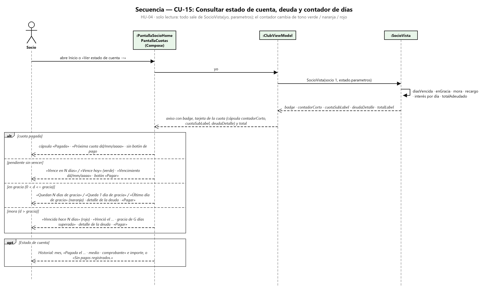

### CU-16 — Ver carnet digital

| Campo | Detalle |
|---|---|
| ID | CU-16 |
| Nombre | Ver carnet digital |
| Actor principal | Socio |
| Actores secundarios / participantes | Pantalla: PantallaCarnet (S_CARNET). Participantes: ClubViewModel (yo), SocioVista (carnetEstado, dniLabel, vigencia). |
| HU relacionada | HU-06 |
| Pantalla(s) | PantallaCarnet (S_CARNET) |
| Precondiciones | Sesión de Socio. |
| Disparador | El Socio toca la pestaña Carnet. |
| Flujo principal | 1. Toca la pestaña Carnet. 2. El sistema muestra la tarjeta con formato de carnet «Club Deportivo»: chip de estado (Vigente / Por vencer si faltan menos de 30 días / Vencido), nombre, DNI, Socio N°, Plan y antigüedad, foto, «Vigencia emitido – vence» y el pie «Cuota al día / en mora / en período de gracia / pendiente». 3. Debajo, el botón «QR de ingreso» (vm.ir(Screen.S_QR), CU-26), la leyenda «Mostrá tu DNI o el QR de ingreso en recepción…» y «Últimos ingresos». |
| Flujos alternativos y de excepción | 2a. Carnet vencido → chip «Vencido» en rojo; el socio debe renovarlo en recepción (CU-08). 3a. Sin ingresos → «Todavía no registraste ingresos.» |
| Postcondiciones | Ninguna modificación. |
| Reglas de negocio | RN1. Estado del carnet: Vencido si venció; Por vencer si faltan menos de 30 días; Vigente en otro caso. RN2. El pie de la tarjeta resume la cuota: al día, en mora, en período de gracia o pendiente. |
| Datos de demo para probarlo | Andres / Socio123: Andrés Weitzel, DNI 38.412.907, Socio N° 01245, Plan Full, carnet Vigente. |
| Diagrama | Diagrama de secuencia UML 2.0 de CU-16 (diagramas/sec_cu16_carnet_digital.png), en la figura siguiente |

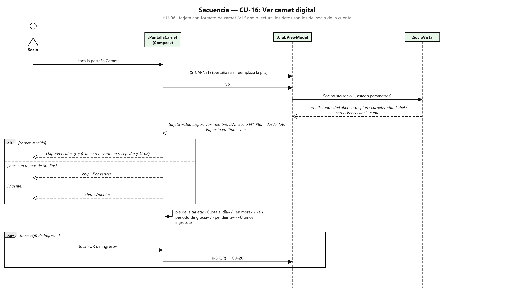

### CU-17 — Consultar rutina asignada

| Campo | Detalle |
|---|---|
| ID | CU-17 |
| Nombre | Consultar rutina asignada |
| Actor principal | Socio |
| Actores secundarios / participantes | Pantalla: PantallaRutinaSocio (y tarjeta «Rutina · hoy» de PantallaSocioHome). Participantes: ClubViewModel (diasDeRutina, diaDeRutina). |
| HU relacionada | HU-10 |
| Pantalla(s) | PantallaRutinaSocio (y tarjeta «Rutina · hoy» del Inicio) |
| Precondiciones | Sesión de Socio. |
| Disparador | El Socio toca la pestaña Rutina. |
| Flujo principal | 1. Abre la pestaña Rutina. 2. El sistema muestra nombre de la rutina, profesora, fecha de actualización y los días; el socio cambia de día (elegirDiaRutina()) y ve los ejercicios numerados con series × repeticiones. |
| Flujos alternativos y de excepción | 2a. Sin rutina asignada → «Todavía no tenés una rutina asignada. Tu profesor la va a cargar en tu próxima clase.» (en el Inicio, la tarjeta dice «Sin rutina» · «Pedile a tu profe»). |
| Postcondiciones | Ninguna modificación. |
| Reglas de negocio | RN1. Solo se ve la rutina propia. RN2. Sin rutina se muestra el aviso para pedirla a la entrenadora. |
| Datos de demo para probarlo | Andres / Socio123: rutina «Hipertrofia 3 días» (Prof. Ana Alvarez), días D1 Tren inferior, D2 Tren superior, D3 Full body. |
| Diagrama | Diagrama de secuencia UML 2.0 de CU-17 (diagramas/sec_cu17_rutina_socio.png), en la figura siguiente |

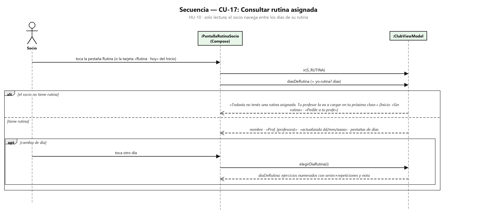

### CU-18 — Solicitar turno de nutrición

| Campo | Detalle |
|---|---|
| ID | CU-18 |
| Nombre | Solicitar turno de nutrición |
| Actor principal | Socio |
| Actores secundarios / participantes | Pantallas: PantallaNutriSocio → PantallaTurno. Participantes: ClubViewModel (slots, elegirSlot, confirmarTurno), ClubRepositorio, ClubDbHelper (SQLite: socio.turno_fecha, turno_hora). |
| HU relacionada | HU-11 |
| Pantalla(s) | PantallaNutriSocio → PantallaTurno («Solicitar turno») |
| Precondiciones | Sesión de Socio sin turno vigente. |
| Disparador | El Socio toca «Confirmar turno» (confirmarTurno()). |
| Flujo principal | 1. En Nutrición toca «Solicitar turno». 2. El sistema muestra la grilla de días y horarios; los ya tomados por otros socios aparecen ocupados. 3. Elige un horario libre (elegirSlot()) y toca «Confirmar turno» (confirmarTurno()). 4. El sistema guarda Turno(fecha, hora), vuelve a Nutrición y muestra «Turno confirmado · dd/mm hh:mm». |
| Flujos alternativos y de excepción | 2a. Los horarios tomados por otro socio no se pueden elegir. 3a. «Confirmar turno» está deshabilitado mientras no haya horario elegido; si igual se invoca confirmarTurno() sin slot, toast «Elegí un horario disponible». |
| Postcondiciones | Turno persistido (turno_fecha, turno_hora); aparece en la agenda de la nutricionista (CU-24). |
| Reglas de negocio | RN1. Hay 3 días × 6 horarios (16:00 a 18:30); un horario tomado por otro socio queda deshabilitado. RN2. «Confirmar turno» está deshabilitado hasta elegir un horario. |
| Datos de demo para probarlo | Andres / Socio123: primero cancelar su turno (CU-19); luego Nutrición → «Solicitar turno». El horario de Valentina (mañana 17:00) aparece ocupado. |
| Diagrama | Diagrama de secuencia UML 2.0 de CU-18 (diagramas/sec_cu18_solicitar_turno.png), en la figura siguiente |

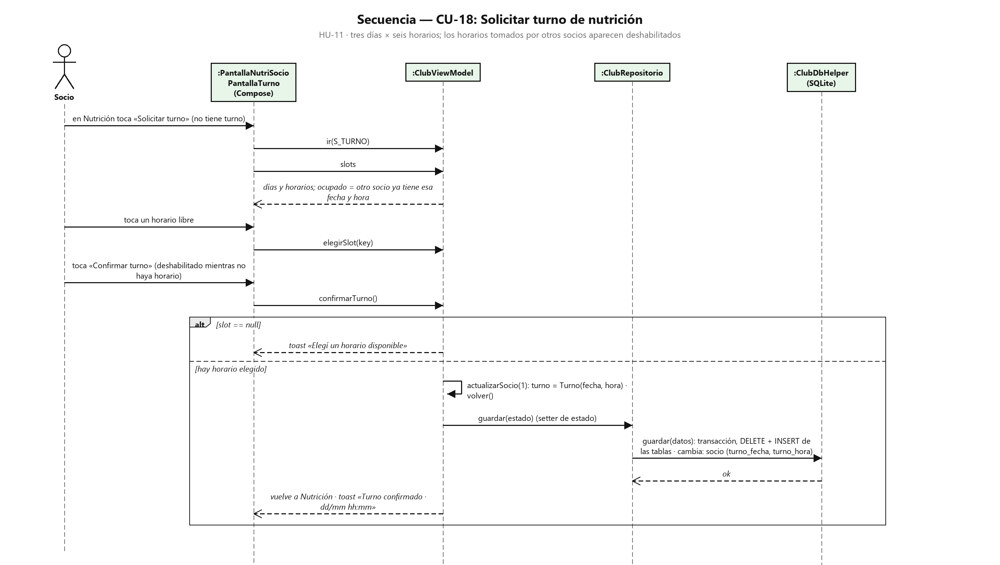

### CU-19 — Cancelar turno de nutrición

| Campo | Detalle |
|---|---|
| ID | CU-19 |
| Nombre | Cancelar turno de nutrición |
| Actor principal | Socio |
| Actores secundarios / participantes | Pantalla: PantallaNutriSocio (hoja «Cancelar turno»). Participantes: ClubViewModel, ClubRepositorio, ClubDbHelper (SQLite: socio). |
| HU relacionada | HU-11 |
| Pantalla(s) | PantallaNutriSocio (hoja «Cancelar turno») |
| Precondiciones | Sesión de Socio con turno vigente. |
| Disparador | El Socio toca «Cancelar turno» (pedirCancelarTurno()). |
| Flujo principal | 1. Toca «Cancelar turno» (pedirCancelarTurno()). 2. El sistema muestra la hoja con el turno a liberar. 3. Confirma «Sí, cancelar»; el sistema borra el turno y muestra «Turno cancelado». |
| Flujos alternativos y de excepción | 3a. Cancela la hoja → el turno se mantiene. |
| Postcondiciones | Horario liberado para otros socios. |
| Reglas de negocio | RN1. Se pide confirmación y el horario queda libre para otros socios. |
| Datos de demo para probarlo | Andres / Socio123: tiene turno dentro de 3 días a las 17:30 → Nutrición → «Cancelar turno» → «Sí, cancelar». |
| Diagrama | Diagrama de secuencia UML 2.0 de CU-19 (diagramas/sec_cu19_cancelar_turno.png), en la figura siguiente |

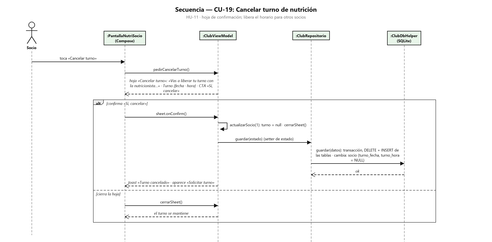

### CU-20 — Consultar información nutricional propia

| Campo | Detalle |
|---|---|
| ID | CU-20 |
| Nombre | Consultar información nutricional propia |
| Actor principal | Socio |
| Actores secundarios / participantes | Pantalla: PantallaNutriSocio. Participantes: ClubViewModel, SocioVista (imc, pesoLabel, alturaLabel, turnoSub). |
| HU relacionada | HU-13 |
| Pantalla(s) | PantallaNutriSocio |
| Precondiciones | Sesión de Socio. |
| Disparador | El Socio toca la pestaña Nutrición. |
| Flujo principal | 1. Abre la pestaña Nutrición. 2. El sistema muestra peso, altura e IMC (o «—» si no hay medidas), objetivo, antecedentes, el historial de consultas (fecha, peso, observaciones), el turno vigente y la nutricionista. |
| Flujos alternativos y de excepción | 2a. Sin consultas → «Sin consultas registradas». |
| Postcondiciones | Ninguna modificación. |
| Reglas de negocio | RN1. IMC = peso / altura²; sin altura se muestra «—». RN2. Solo ve su propia ficha. |
| Datos de demo para probarlo | Andres / Socio123: 62,4 kg · 1,68 m · IMC 22,1; objetivo «Recomposición corporal, +masa muscular»; tres consultas en el historial. |
| Diagrama | Diagrama de secuencia UML 2.0 de CU-20 (diagramas/sec_cu20_info_nutricional.png), en la figura siguiente |

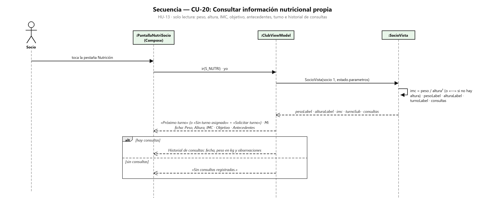

### CU-21 — Registrar presencia propia

| Campo | Detalle |
|---|---|
| ID | CU-21 |
| Nombre | Registrar presencia propia |
| Actor principal | Entrenadora |
| Actores secundarios / participantes | Pantalla: PantallaProfesorHome. Participantes: ClubViewModel, ClubRepositorio, ClubDbHelper (SQLite: sesion.profe_presente). |
| HU relacionada | HU-08 |
| Pantalla(s) | PantallaProfesorHome |
| Precondiciones | Sesión de Entrenadora. |
| Disparador | La Entrenadora toca «Marcar presencia» (marcarPresencia()). |
| Flujo principal | 1. En el Inicio la tarjeta «Mi asistencia de hoy» muestra «Sin marcar» y el botón «Marcar presencia» (marcarPresencia()). 2. El sistema registra profePresente = true, lo persiste (tabla sesion) y muestra «Presencia registrada · hh:mm»; la tarjeta pasa a «Presente» y el botón desaparece. |
| Flujos alternativos y de excepción | 1a. Si ya está marcada, no hay botón: no se puede marcar dos veces desde la pantalla. |
| Postcondiciones | Presencia persistida en la tabla sesion (profe_presente). |
| Reglas de negocio | RN1. Una vez marcada, el botón desaparece y la tarjeta muestra «Presente». RN2. El Administrativo la ve en Inicio → Supervisión. |
| Datos de demo para probarlo | Ana / Prof123 → Inicio → «Marcar presencia» → toast «Presencia registrada · hh:mm». |
| Diagrama | Diagrama de secuencia UML 2.0 de CU-21 (diagramas/sec_cu21_presencia.png), en la figura siguiente |

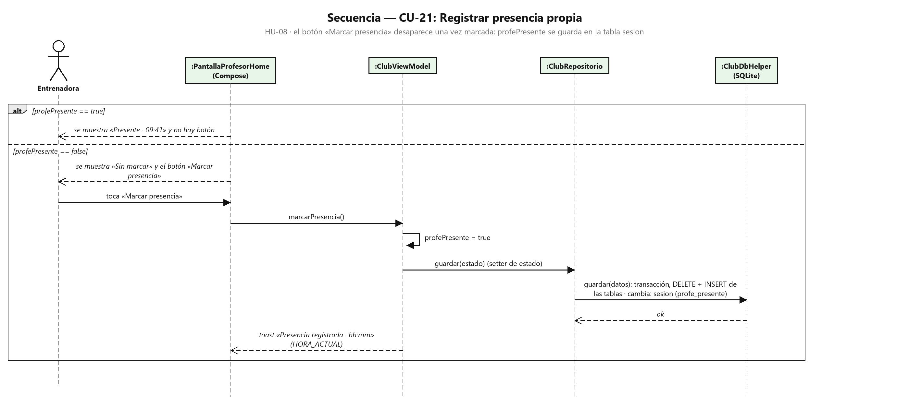

### CU-22 — Registrar asistencia de clase

| Campo | Detalle |
|---|---|
| ID | CU-22 |
| Nombre | Registrar asistencia de clase |
| Actor principal | Entrenadora |
| Actores secundarios / participantes | Pantallas: PantallaProfesorHome → PantallaAsistencia. Participantes: ClubViewModel, ClubRepositorio, ClubDbHelper (SQLite: asistencia_clase, asistencia). |
| HU relacionada | HU-08 |
| Pantalla(s) | PantallaProfesorHome → PantallaAsistencia |
| Precondiciones | Sesión de Entrenadora; la clase es suya (Musculación 18:00, Funcional 19:30). |
| Disparador | La Entrenadora toca una clase (abrirAsistencia()). |
| Flujo principal | 1. Desde el Inicio toca una clase (abrirAsistencia()) o en la pestaña Asistencia elige la clase (elegirClase()). 2. El sistema lista los inscriptos con su marca de presente. 3. Toca cada socio para alternar presente / ausente (alternarAsistencia()). 4. Toca «Guardar asistencia» (guardarAsistencia()); el sistema muestra «Asistencia guardada · {clase} · n/m presentes» y vuelve al Inicio. |
| Flujos alternativos y de excepción | 3a. Cambia de clase → cada clase conserva su propia lista de presentes. |
| Postcondiciones | Asistencia por clase persistida (asistencia_clase, asistencia); el Inicio muestra presentes / inscriptos. |
| Reglas de negocio | RN1. Solo las clases que dicta: Musculación 18:00 y Funcional 19:30. RN2. Cada clase conserva su propia lista de presentes. |
| Datos de demo para probarlo | Ana / Prof123 → Musculación (inscriptos: Andrés, Lucas, Julián, Camila; presentes de base Julián y Camila) → tocar a Andrés → «Guardar asistencia». |
| Diagrama | Diagrama de secuencia UML 2.0 de CU-22 (diagramas/sec_cu22_asistencia.png), en la figura siguiente |

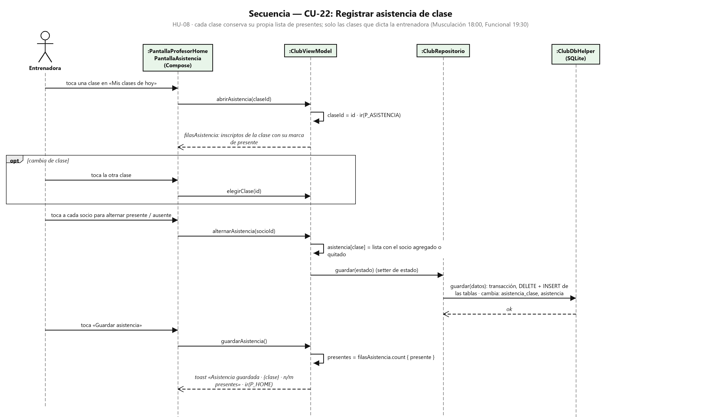

### CU-23 — Crear y asignar rutina

| Campo | Detalle |
|---|---|
| ID | CU-23 |
| Nombre | Crear y asignar rutina |
| Actor principal | Entrenadora |
| Actores secundarios / participantes | Pantallas: PantallaRutinasProfesor → PantallaRutinaEdit. Participantes: ClubViewModel, SocioVista (bloqueaRutina, bloqueoMotivo), ClubRepositorio, ClubDbHelper (SQLite: socio.rutina_json). |
| HU relacionada | HU-09 |
| Pantalla(s) | PantallaRutinasProfesor → PantallaRutinaEdit («Rutina del socio») |
| Precondiciones | Sesión de Entrenadora. El socio pertenece a sus actividades. |
| Disparador | La Entrenadora abre un socio de la lista (abrirRutina()). |
| Flujo principal | 1. Abre Rutinas: lista de socios de Musculación / Funcional con «Crear» o «Ver» y las rutinas pendientes. 2. Abre un socio (abrirRutina()); si no tenía rutina el editor arranca con tres días vacíos. 3. Elige el día (elegirDiaEdicion()), escribe el ejercicio, series (1..20) y repeticiones (1..100) y toca «Nuevo ejercicio» (agregarEjercicio()); puede quitar ejercicios (quitarEjercicio()). 4. Toca «Guardar y asignar rutina» (guardarRutina()): se guardan los días con ejercicios, nombre «Rutina personalizada» (o el anterior), profesora y fecha de hoy; toast «Rutina asignada a {nombre} · visible en su app». |
| Flujos alternativos y de excepción | 2a. El socio no está habilitado (cuota en mora o carnet vencido) o no tiene apto físico → el editor muestra «No se puede asignar rutina: {motivo}. El socio debe regularizar la situación en recepción.» (motivos: «cuota en mora», «carnet vencido», «falta la ficha médica») y no ofrece formulario. 3a. Nombre del ejercicio vacío → toast «Ingresá el nombre del ejercicio»; series o repeticiones no enteras o fuera de rango → «Las series deben estar entre 1 y 20.» / «Las repeticiones deben estar entre 1 y 100.» (o «… deben ser un número entero.») 4a. Ningún día con ejercicios → toast «Agregá al menos un ejercicio». |
| Postcondiciones | Rutina persistida (rutina_json) y visible para el socio (CU-17). |
| Reglas de negocio | RN1. Solo se asigna a socios habilitados con apto físico (permiteRutina = hab && ficha). RN2. Series 1..20 y repeticiones 1..100; se guardan solo los días con ejercicios. |
| Datos de demo para probarlo | Ana / Prof123 → Rutinas. Martín Ledesma (36.410.228, habilitado, sin rutina): cargar «Sentadilla» 4 × 10 → «Guardar y asignar rutina». Lucas Benítez (en mora) → «No se puede asignar rutina: cuota en mora…». |
| Diagrama | Diagrama de secuencia UML 2.0 de CU-23 (diagramas/sec_cu23_rutina.png), en la figura siguiente |

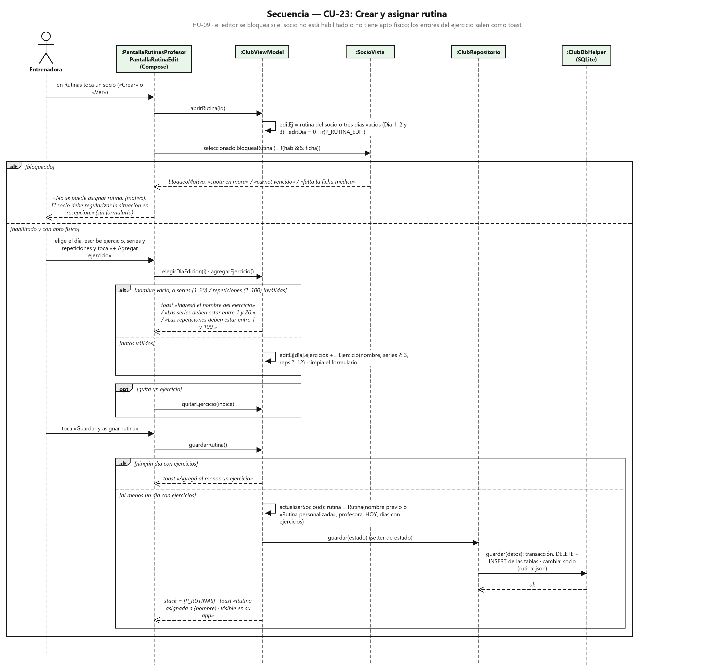

### CU-24 — Consultar agenda de turnos

| Campo | Detalle |
|---|---|
| ID | CU-24 |
| Nombre | Consultar agenda de turnos |
| Actor principal | Nutricionista |
| Actores secundarios / participantes | Pantalla: PantallaAgenda. Participantes: ClubViewModel (agenda); PantallaFichaNutricional para el detalle. |
| HU relacionada | HU-11 |
| Pantalla(s) | PantallaAgenda |
| Precondiciones | Sesión de Nutricionista. |
| Disparador | La Nutricionista abre la pestaña Agenda. |
| Flujo principal | 1. Abre la pestaña Agenda. 2. El sistema agrupa los turnos por día (hoy y los próximos), ordenados por hora, con el nombre del socio. 3. Toca un turno para abrir la ficha nutricional del socio (abrirFicha(), CU-25). |
| Flujos alternativos y de excepción | 2a. Un día sin turnos no se lista. |
| Postcondiciones | Ninguna modificación. |
| Reglas de negocio | RN1. Se agrupan por día (hoy, mañana y dentro de 3 días) y se ordenan por hora. RN2. Un día sin turnos no se lista. |
| Datos de demo para probarlo | Leandro / Nut123: hoy Sofía Acosta 16:30 y Julián Paredes 18:00; mañana Valentina Ruiz 17:00; dentro de 3 días Andrés Weitzel 17:30. |
| Diagrama | Diagrama de secuencia UML 2.0 de CU-24 (diagramas/sec_cu24_agenda.png), en la figura siguiente |

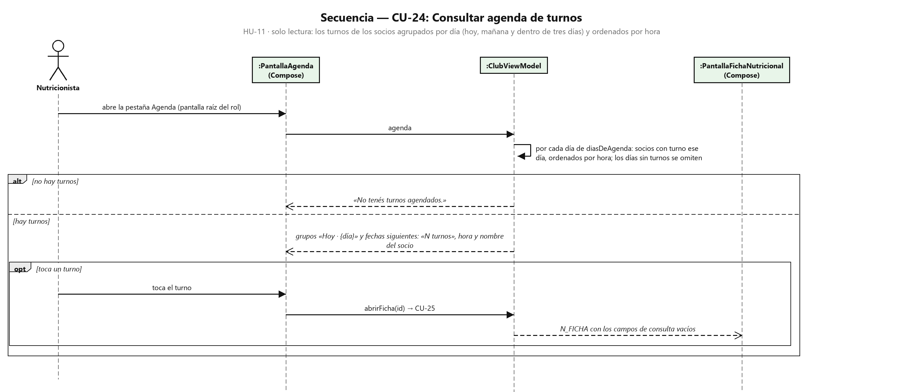

### CU-25 — Registrar consulta nutricional (ficha nutricional)

| Campo | Detalle |
|---|---|
| ID | CU-25 |
| Nombre | Registrar consulta nutricional (ficha nutricional) |
| Actor principal | Nutricionista |
| Actores secundarios / participantes | Pantallas: PantallaFichas → PantallaFichaNutricional. Participantes: ClubViewModel, Validaciones, ClubRepositorio, ClubDbHelper (SQLite: socio.nut_peso, nut_altura, consultas_json, turno). |
| HU relacionada | HU-12 |
| Pantalla(s) | PantallaFichas → PantallaFichaNutricional |
| Precondiciones | Sesión de Nutricionista; socio elegido desde Agenda o Fichas. |
| Disparador | La Nutricionista toca «Guardar en historial» (guardarConsulta()). |
| Flujo principal | 1. El sistema muestra la ficha: datos del socio, peso, altura, IMC, objetivo, antecedentes e historial de consultas. 2. En «Registrar consulta de hoy» ingresa peso (kg, obligatorio, 20..300, con coma o punto), altura (m, opcional, 0,50..2,50) y observaciones. 3. Toca «Guardar en historial» (guardarConsulta()). 4. El sistema actualiza peso y altura, antepone Consulta(hoy, peso, observaciones o «Control de rutina.»), consume el turno si era de hoy, limpia el formulario y muestra «Consulta guardada en el historial». |
| Flujos alternativos y de excepción | 3a. Peso vacío → toast «Ingresá el peso.»; no numérico → «El peso debe ser un número (ej.: 62,4).»; fuera de rango → «El peso debe estar entre 20 y 300 kg.» 3b. Altura no numérica → «La altura debe ser un número en metros (ej.: 1,68).»; fuera de rango → «La altura debe estar entre 0,50 y 2,50 m.» |
| Postcondiciones | Consulta persistida (consultas_json, nut_peso, nut_altura); el turno de hoy queda liberado; el socio la ve en CU-20. |
| Reglas de negocio | RN1. Peso obligatorio 20..300 kg; altura opcional 0,50..2,50 m; acepta coma o punto. RN2. Sin observaciones se guarda «Control de rutina.». RN3. Si el turno era de hoy, queda consumido. |
| Datos de demo para probarlo | Leandro / Nut123 → Fichas → Sofía Acosta (turno hoy 16:30): peso «57,4», observaciones «Bajó 800 g.» → IMC 21,6. Error: peso vacío → «Ingresá el peso.» |
| Diagrama | Diagrama de secuencia UML 2.0 de CU-25 (diagramas/sec_cu25_consulta.png), en la figura siguiente |

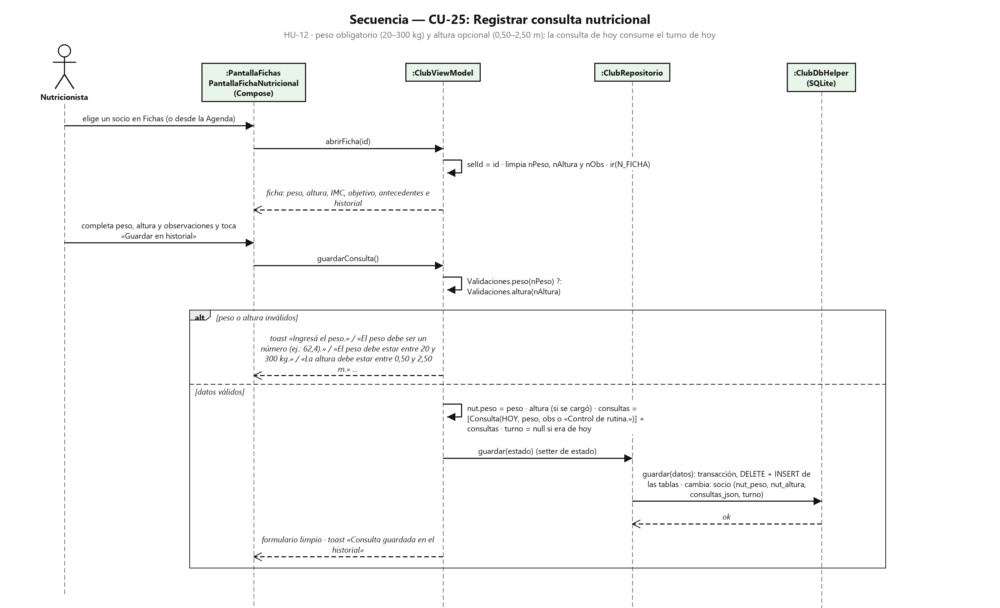

### CU-26 — Mostrar QR de ingreso («extend» de CU-16)

| Campo | Detalle |
|---|---|
| ID | CU-26 |
| Nombre | Mostrar QR de ingreso («extend» de CU-16) |
| Actor principal | Socio |
| Actores secundarios / participantes | Pantallas: PantallaCarnet → PantallaQrIngreso (Screen.S_QR). Participantes: ClubViewModel, SocioVista (qrCarnet, estadoCorto, badge), composable CodigoQr (ZXing core). |
| HU relacionada | HU-06 |
| Pantalla(s) | PantallaCarnet → PantallaQrIngreso (S_QR, «QR de ingreso») |
| Precondiciones | Sesión de Socio; pantalla Carnet abierta (CU-16). |
| Disparador | El Socio toca «QR de ingreso» en el carnet (vm.ir(Screen.S_QR)). |
| Flujo principal | 1. Toca «QR de ingreso» en el carnet digital (vm.ir(Screen.S_QR)); la pantalla se apila sobre el carnet con flecha para volver. 2. El sistema muestra nombre, «N° · DNI · Plan», la cápsula estadoCorto y, más abajo, «Carnet vigente · vence dd/mm/aaaa» con el badge del socio. 3. Dibuja el código QR (composable CodigoQr, ZXing core, sin cámara) cuyo contenido es SocioVista.qrCarnet: «CLUB DEPORTIVO · CARNET DE SOCIO», N° de socio, Socio, DNI, Plan, Carnet emitido, Carnet vence y Estado. 4. Toca la flecha o el botón atrás (volver()) para regresar al carnet. |
| Flujos alternativos y de excepción | 2a. Carnet vencido o socio en mora → la cápsula y el campo Estado del QR lo indican; el QR no habilita por sí mismo el ingreso (lo decide el control de acceso, CU-09). |
| Postcondiciones | Ninguna modificación; el QR se genera en el dispositivo a partir de los datos del socio. |
| Reglas de negocio | RN1. El QR contiene texto plano con los datos del carnet (SocioVista.qrCarnet), de menos de 300 caracteres. RN2. El QR no habilita por sí mismo el ingreso: lo decide CU-09. |
| Datos de demo para probarlo | Andres / Socio123 → Carnet → «QR de ingreso»: «Estado: Habilitado · Cuota pendiente», carnet que vence en 204 días. |
| Diagrama | Diagrama de secuencia UML 2.0 de CU-26 (diagramas/sec_cu26_qr_ingreso.png), en la figura siguiente |

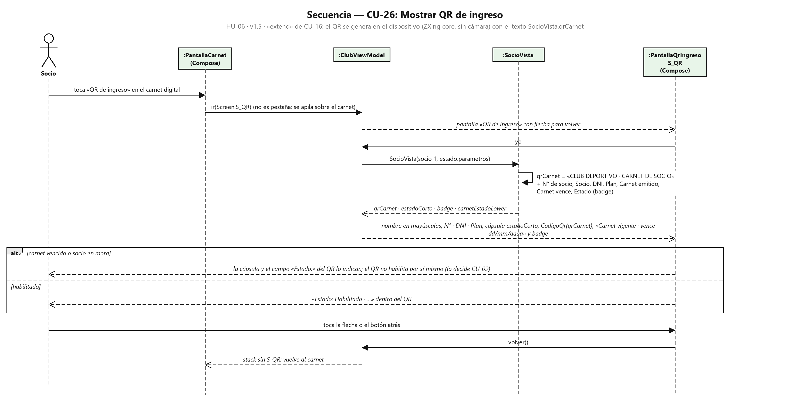

## 5. Diagrama de clases del dominio (UML 2.0)

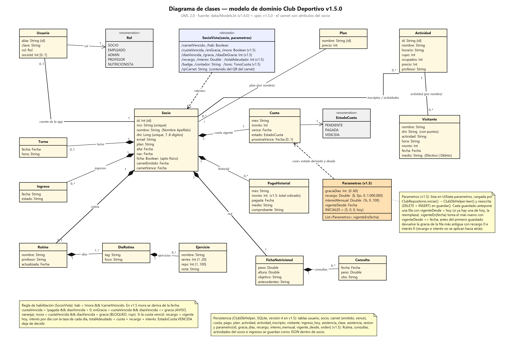

Modelo tomado de data/Models.kt: Socio (el carnet son sus atributos carnetEmitido / carnetVence), Cuota, PagoHistorial, Plan, Actividad, Visitante, Rutina → DiaRutina → Ejercicio, FichaNutricional → Consulta, Turno, Ingreso, Usuario y Rol. SocioVista es la clase derivada que aplica la regla de habilitación. Parametros es la entidad con vigencia por fecha; EstadoCuota.VENCIDA deja de decidir la mora.

## 6. Máquina de estados de la cuota (UML 2.0)

Pendiente → En período de gracia → En mora se derivan de d = días desde el vencimiento y de la gracia configurada; cualquiera de los tres pasa a Pagada con el pago: por la cuota sola si no venció, y por cuota + recargo + interés desde que venció. La cuota pagada abre la del mes siguiente.

## 7. Diagrama de actividad: alta de socio (UML 2.0)

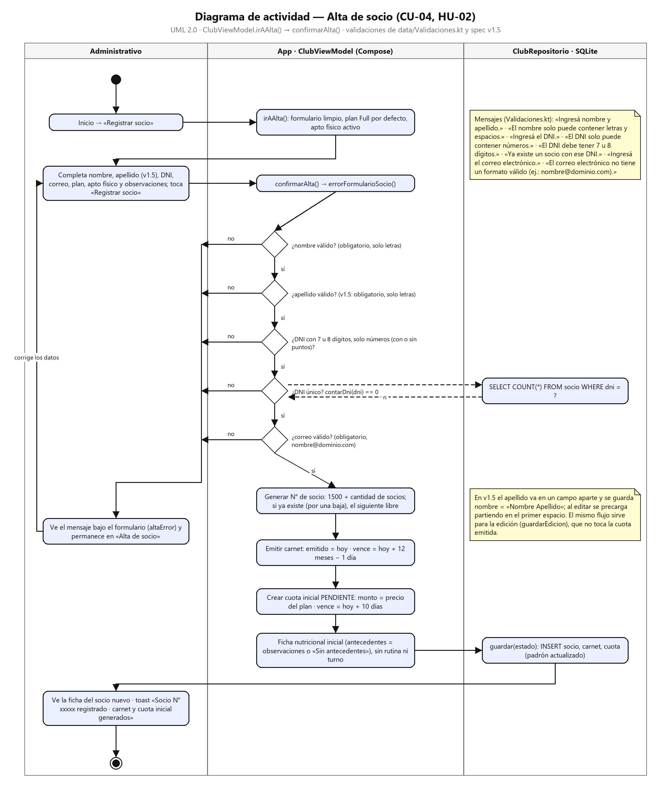

Validaciones en orden: nombre, apellido, DNI de 7 u 8 dígitos, correo con formato y DNI único (COUNT en SQLite); luego N° de socio, carnet por 12 meses, cuota inicial a 10 días y ficha nutricional inicial.

## 8. Trazabilidad HU → CU → pantalla → prueba automatizada

Las pruebas están en app/src/test/java/ar/edu/ifts29/clubdeportivo; sin aclaración son de ClubViewModelTest.

| HU | CU | Pantalla(s) | Prueba automatizada |
|---|---|---|---|
| HU-01 | CU-01 | PantallaLogin (LoginActivity) → Activity del rol | HU-01 - una credencial invalida no abre sesion; HU-01 - el usuario se normaliza y el rol sale de la cuenta; HU-01 - cada rol aterriza en su propia pantalla; cada rol abre su Activity (NavegacionActivitiesTest) |
| HU-01 | CU-02 | PantallaPerfil (hoja de confirmación) | HU-01 - cerrar sesion vuelve al login; cerrar sesion la cierra para la proxima Activity (NavegacionActivitiesTest) |
| HU-02 | CU-04 | PantallaAlta (E_ALTA, «Alta de socio») | HU-02 - el alta valida nombre, DNI y duplicados; HU-02 - el alta rechaza formatos incorrectos y datos faltantes; HU-02 - el alta genera numero de socio, carnet y cuota inicial; nombre y apellido por separado (ValidacionesTest) |
| HU-02 (CRUD) | CU-05 | PantallaAlta en modo edición (E_EDITAR, «Editar socio») | editar precarga los datos y guarda los cambios (CrudSociosTest); editar valida igual que el alta y no choca con su propio DNI (CrudSociosTest) |
| HU-02 (CRUD) | CU-06 | PantallaFichaSocio (hoja «Dar de baja») | la baja pide confirmacion y quita al socio de clases y asistencias (CrudSociosTest); un alta despues de una baja no repite el numero de socio (CrudSociosTest); el socio dado de baja no puede iniciar sesion (CrudSociosTest) |
| HU-02, HU-05, HU-14 | CU-03 | PantallaSocios → PantallaFichaSocio | los filtros y la busqueda del listado de socios |
| HU-03 | CU-11 | PantallaVisitantes → PantallaVisitanteNuevo («Ingreso de visitante») | HU-03 - sin cupo el ingreso de visitante se bloquea; HU-03 - con cupo se registra el pago diario con fecha y medio; HU-03 - el cupo de hoy cuenta a los visitantes de hoy; HU-03 - un DNI ya cobrado hoy no se registra dos veces |
| HU-04 | CU-07 | PantallaFichaSocio (hoja «Registrar pago») | HU-04 - el cobro en caja habilita al socio en mora; HU-04 - el cobro en caja abre la cuota siguiente y deja comprobante; HU-04 - una cuota pagada no se cobra dos veces; el recargo y el interes vigentes se suman a la deuda del moroso |
| HU-04 | CU-14 | PantallaSocioHome / PantallaCuotas → PantallaPagar → PantallaPagoOk | HU-04 - el pago simulado deja la cuota paga y emite comprobante; HU-04 - una cuota pagada no se cobra dos veces |
| HU-04 | CU-15 | PantallaSocioHome, PantallaCuotas («Estado de cuenta») | las etiquetas de vencimiento se redactan segun los dias restantes; las capsulas de estado y de cuota resumen la situacion en pocas palabras; el detalle de la deuda siempre suma el total aunque haya centavos |
| HU-05 | CU-09 | PantallaAcceso | HU-05 - el control de acceso resuelve los cuatro casos; la habilitacion combina mora y vigencia del carnet; la gracia configurada decide si la cuota vencida bloquea; la demo trae un socio en gracia con el carnet por vencer |
| HU-05 | CU-10 | PantallaAcceso (resultado «Permitido») | HU-05 - registrar el ingreso lo agrega al dia y al historial del socio |
| HU-06 | CU-16 | PantallaCarnet (S_CARNET) | la demo trae un socio en gracia con el carnet por vencer (asserta carnetEstado «Por vencer»); HU-07 - renovar el carnet lo emite por doce meses y habilita |
| HU-06 | CU-26 | PantallaCarnet → PantallaQrIngreso (S_QR, «QR de ingreso») | el QR de ingreso es una pantalla propia con los datos del carnet; el QR del carnet se decodifica con los datos del carnet (QrCarnetTest) |
| HU-07 | CU-08 | PantallaFichaSocio (hoja «Renovar carnet» / «Reemitir carnet») | HU-07 - renovar el carnet lo emite por doce meses y habilita |
| HU-08 | CU-21 | PantallaProfesorHome | HU-08 - la profesora marca su propia presencia |
| HU-08 | CU-22 | PantallaProfesorHome → PantallaAsistencia | HU-08 - asistencia por clase |
| HU-09 | CU-23 | PantallaRutinasProfesor → PantallaRutinaEdit («Rutina del socio») | HU-09 - crear y asignar una rutina; HU-09 - la rutina se bloquea por mora o por falta de apto fisico; series y repeticiones (ValidacionesTest) |
| HU-10 | CU-17 | PantallaRutinaSocio (y tarjeta «Rutina · hoy» del Inicio) | HU-09 - crear y asignar una rutina (verifica la rutina asignada; la pantalla del socio no tiene prueba propia) |
| HU-11 | CU-18 | PantallaNutriSocio → PantallaTurno («Solicitar turno») | HU-11 - cancelar y volver a pedir turno |
| HU-11 | CU-19 | PantallaNutriSocio (hoja «Cancelar turno») | HU-11 - cancelar y volver a pedir turno |
| HU-11 | CU-24 | PantallaAgenda | HU-12 - la agenda ordena los turnos del dia |
| HU-12 | CU-25 | PantallaFichas → PantallaFichaNutricional | HU-12 - registrar una consulta actualiza la ficha y consume el turno; peso obligatorio y en rango, con coma o punto (ValidacionesTest); altura opcional pero en rango (ValidacionesTest) |
| HU-13 | CU-20 | PantallaNutriSocio | HU-12 - registrar una consulta actualiza la ficha y consume el turno (IMC e historial); HU-02 - el alta genera numero de socio, carnet y cuota inicial (IMC «—») |
| HU-14 | CU-12 | PantallaReportes | HU-14 - vencen hoy, esta semana y mora salen de pestanias distintas; HU-14 - los pagos diarios se consultan por fecha; HU-14 - cobrar la cuota que vence hoy la saca del listado; HU-14 - los ingresos de hoy cuentan solo a los visitantes de hoy |
| Regla de negocio de HU-04 y HU-05 (sin HU nueva; ver «A confirmar») | CU-13 | PantallaPerfil → sección «Configuración del club» | los parametros guardan su vigencia y el interes se calcula por tramos; los parametros rechazan valores que no son numeros finitos |

## 9. A confirmar

1. CU-21: la tarjeta de la Entrenadora muestra el texto fijo «Presente · 09:41» mientras el toast usa la hora real (HORA_ACTUAL). No hay spec que diga cuál debe mostrarse.
2. CU-23: el motivo «falta la ficha médica» no se alcanza con los datos de demo desde la lista de la Entrenadora (los socios sin apto, como Valentina Ruiz, no cursan Musculación ni Funcional); solo lo ejercita la prueba «HU-09 - la rutina se bloquea por mora o por falta de apto fisico».
3. CU-13: no hay historia de usuario propia en el README; se trata como regla de negocio de HU-04 y HU-05.
4. CU-16, CU-17, CU-20: las pantallas del Socio no tienen prueba automatizada propia (solo se cubren las reglas de SocioVista y del ViewModel que usan).
5. CU-14 / CU-18: las guardas del ViewModel (cuota ya pagada, turno sin horario) no son alcanzables desde la pantalla porque el botón no se muestra o está deshabilitado; se documentan como defensas del ViewModel.
6. CU-09: el texto de «No encontrado» sugiere registrar al visitante, pero la tarjeta solo ofrece el botón «Registrar socio»; no hay atajo a CU-11.
7. CU-12: las listas «Vencen hoy» / «Esta semana» filtran por estado PENDIENTE guardado; una cuota guardada como VENCIDA (Lucas y Tomás en la semilla) aparece en «En mora» y no en esas listas. Es coherente, pero el spec no lo explicita.
8. Importes de la demo: dependen de la fecha del dispositivo; las pruebas fijan el 08/09/2026 (con esa fecha Tomás Giménez debe $18.520). Los de Lucas ($12.848) y Rocío ($12.536) no cambian con la fecha mientras rijan los parámetros de la semilla.

## Anexo. Cómo regenerar los diagramas

Los PNG se generan con Python 3 + Pillow desde `herramientas/` (`python dia_casos_de_uso.py`, `dia_clases.py`, `dia_estados_cuota.py`, `dia_actividad_alta.py` y `dia_secuencias.py`, que dibuja los 26 diagramas de `cu_secuencias.py`). `generar_puml.py` escribe en `diagramas/` la fuente PlantUML (`.puml`) equivalente de cada diagrama. El documento (.md y .docx) sale de `generar_doc.py` y el PDF se convierte con LibreOffice en modo headless.
